<picture>
  <source media="(prefers-color-scheme: dark)" srcset="docs/readme-kit/assets/hero-dark.svg">
  
</picture>

<p align="center">
  <picture>
    <source media="(prefers-color-scheme: dark)" srcset="https://readme-typing-svg.demolab.com?font=Plus+Jakarta+Sans&weight=600&size=20&duration=2800&pause=900&color=C090F5&center=true&vCenter=true&width=760&lines=Record+the+artisan%2C+the+craft+and+the+place;Interviews+that+transcribe+themselves;Every+voice+in+English%2C+turn+by+turn;Works+where+there+is+no+signal;A+dataset+ready+for+research">
    
  </picture>
</p>

<p align="center">
  
  
  
  
  
</p>

The **Field Repository** is the documentation portal of the AI Centre of Excellence at IIT Kharagpur.
Researchers record artisans, crafts, workshops, products, tools and processes, run structured
interviews that transcribe and translate themselves, send the work up a review ladder, and export a
research-ready dataset. The web app and the Android app share one API, and the Android app keeps
working where the craft actually happens: in a village with no signal.

<picture>
  <source media="(prefers-color-scheme: dark)" srcset="docs/readme-kit/assets/stats-dark.svg">
  
</picture>

<picture>
  <source media="(prefers-color-scheme: dark)" srcset="docs/readme-kit/assets/divider-dark.svg">
  
</picture>

## &nbsp; What it does

<picture>
  <source media="(prefers-color-scheme: dark)" srcset="docs/readme-kit/assets/cards-dark.svg">
  
</picture>

| Area | What a researcher gets | Read more |
|---|---|---|
| Records | Artisans, crafts, workshops, products, tools, processes, interviews and media, each linked to the others when it is saved | [WALKTHROUGH.md](docs/WALKTHROUGH.md) |
| Crafts | One master list from the Ministry of Textiles (Annexure I): 9 categories, their sub-categories and every craft with its states and GI status | [CRAFTS.md](docs/CRAFTS.md) |
| Interviews | Questionnaire v2 on one shared engine: sessions, takes, coverage, canonical answers, chips and filters | [questionnaire/API.md](docs/questionnaire/API.md) |
| Transcripts | Scribe v2 words, Gemini 3.8 Flash English, a viewer that follows the audio, Ask, quote cards and a craft glossary | [TRANSCRIPT_PIPELINE.md](docs/TRANSCRIPT_PIPELINE.md) |
| Review | A six-tier ladder; each tier reviews the one below | [PERMISSIONS.md](docs/PERMISSIONS.md) |
| Data | A browser laid out as folders, report workbooks, and a streaming dataset API | [DATASET_API.md](docs/DATASET_API.md) |
| Field app | Android with an offline outbox, on-device dictation and card QR scanning | [android/README.md](android/README.md) |

<picture>
  <source media="(prefers-color-scheme: dark)" srcset="docs/readme-kit/assets/divider-dark.svg">
  
</picture>

## &nbsp; How it works

<picture>
  <source media="(prefers-color-scheme: dark)" srcset="docs/readme-kit/assets/pipeline-dark.svg">
  
</picture>

Both clients call one FastAPI service behind CloudFront. Media never passes through the API: the
client asks for a signed URL and uploads straight to S3, then confirms. A separate queue worker does
the slow work (transcription, translation, measurement), so a request never waits on ffmpeg or a
model.

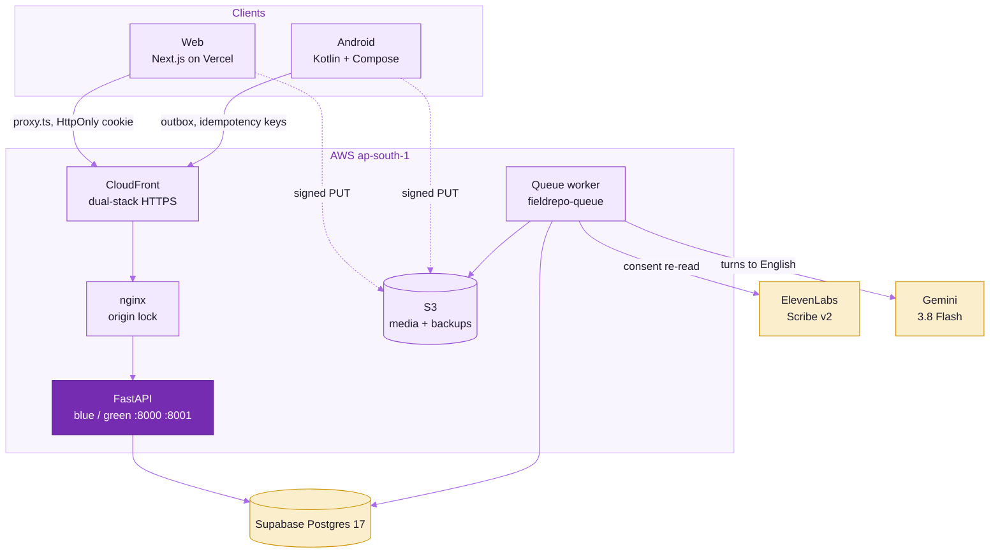

| Layer | What runs there | Where it is described |
|---|---|---|
| Web | Next.js 16, Tailwind 4, framer-motion; the session lives in an HttpOnly cookie and every call goes through `frontend/proxy.ts` | [DEPLOYMENT_VERCEL.md](docs/DEPLOYMENT_VERCEL.md) |
| Android | Kotlin, Jetpack Compose, target SDK 37; an outbox that replays with idempotency keys | [android/README.md](android/README.md) |
| Edge | CloudFront, dual-stack so IPv6-only mobile networks reach it; the box answers CloudFront alone | [INFRA_ORIGIN_LOCK.md](docs/INFRA_ORIGIN_LOCK.md) |
| API | FastAPI on CPython 3.15.2, Prisma, two loopback ports behind nginx for zero-downtime releases | [ARCHITECTURE.md](docs/ARCHITECTURE.md) |
| Queue | `python -m app.worker` as its own systemd unit: transcription, translation, measurement, backfill | [MEDIA_PIPELINE.md](docs/MEDIA_PIPELINE.md) |
| Data | Supabase Postgres 17 in ap-south-1 with RLS on every table; media in S3 | [DATA_MODEL.md](docs/DATA_MODEL.md) |

<picture>
  <source media="(prefers-color-scheme: dark)" srcset="docs/readme-kit/assets/divider-dark.svg">
  
</picture>

## &nbsp; Transcripts and AI

<picture>
  <source media="(prefers-color-scheme: dark)" srcset="docs/readme-kit/assets/pipeline-transcript-dark.svg">
  
</picture>

Every recording a researcher ticks for **Transcribe and translate** (audio or video) goes through the
same two queue steps, in both portals, from code shared byte for byte with the designer portal.

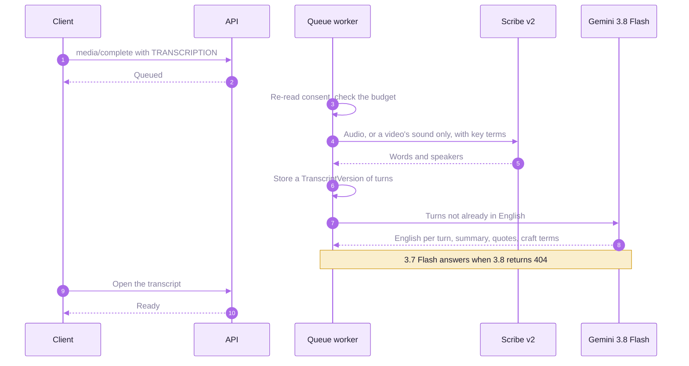

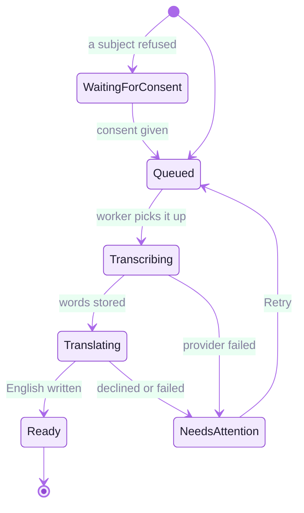

| Feature | What it does | Model or engine | Who sees it |
|---|---|---|---|
| Transcription | Words, speakers and timings; key terms from the artisan, the craft, the glossary and the master list | ElevenLabs Scribe v2; Deepgram Nova-3 and Whisper further down the admin-ranked chain | everyone who may read the recording |
| Translation | English for every turn; turns already in English are marked and not sent | Gemini 3.8 Flash, falling back to 3.7 Flash | everyone who may read it |
| Summary and quotes | Five summary lines and up to five key quotes with their English; edit and regenerate on web and Android | Gemini 3.8 Flash | uploader and admins edit |
| Refine | Rewrites a stored transcript as clean dialogue, optionally translated; approve or reject the result | Gemini 3.8 Flash | uploader and content admins |
| Ask | Answers a question from this one transcript, with citations | Gemini 3.8 Flash | readers |
| Autodraft | Drafts answers to a questionnaire take's open questions; a person accepts each one | Gemini 3.8 Flash | researchers |
| Quote cards | An image (and audio clip) of a quote; refused when the artisan withdrew consent | rendered on the server | readers |
| Craft glossary | Craft terms heard across transcripts, with how often | from the Gemini pass | readers |
| Grid measurement | Length and breadth from one top-down photo on a grid sheet, height from a side photo | Gemini 3.8 Flash (`GEMINI_MEASUREMENT_MODEL`) | the form that asked |
| Dictation | Speak into any prose field on Android | the phone's on-device speech pack first, the network recogniser second | the person typing |
| Card scanning | Reads an artisan card's signed QR | ML Kit barcode scanning, on the phone | Android |
| Voice Isolator | Cleans a transcribed recording into a copy beside the original | ElevenLabs Voice Isolator | built, switched off |

<picture>
  <source media="(prefers-color-scheme: dark)" srcset="docs/readme-kit/assets/cards-ai-dark.svg">
  
</picture>

**Provider defaults.** Every text job on the deployment's key runs on Gemini first. OpenAI
(`gpt-6-luna`, GPT-6 Luna) and Anthropic (`claude-sonnet-5-5`, Claude Sonnet 5.5) are used only when
an operator sets `AI_TEXT_PROVIDER`, or when a researcher brings their own key and picks them.

**Consent and money.** Consent is re-read immediately before every external send: both queue steps,
retranslate, Ask, autodraft and quote cards. Spend is counted per portal against a monthly budget
(USD 100 by default): admins get one notice at 80 %, and at 100 % transcription pauses and translation
waits. A provider's HTTP 402 holds the job for 15 minutes without spending an attempt. Cost and model
badges are shown to Admin, Master Admin and Ministry Admin only.

### The transcript viewer

| On web and Android | |
|---|---|
| Karaoke | The word being spoken lights up as the audio or video plays |
| Auto-follow | The view scrolls with playback and lets go the moment the reader scrolls |
| Reading mode | Prose without the timing chrome, for reading an interview straight through |
| Marks | Marked points on the timeline, mark bubbles, an all-marks toggle, a colour per speaker |
| Editing | Per-turn edits with history; an edited original marks its English out of date |
| Speakers | Rename once and it applies to every turn, version and copy |
| Copy and download | Original, English or both, as Markdown, Word, SRT or VTT |
| Declined English | When Gemini declines, an editor can paste or type the English |

### Uploads and the admin switches (0.0.10)

Each audio or video file carries its own **Transcribe and translate** box at upload, on web and
Android; nothing is queued that nobody asked for. Video is transcribed as its sound only, and the
stored video is never changed. A master admin has three switches, all **off** by default:

| Switch | When on |
|---|---|
| Transcribe and translate all new videos | every new video is queued, whatever the box at upload says |
| Transcribe and translate all new audio | the same for audio |
| Transcribe and translate all previously uploaded media | the queue worker backfills, oldest first, at most 25 open jobs at a time, inside the month's budget, after showing the estimate and asking first |

The backfill switch stays off in production until the owner has seen the dry run (launch list D40).

<picture>
  <source media="(prefers-color-scheme: dark)" srcset="docs/readme-kit/assets/divider-dark.svg">
  
</picture>

## &nbsp; Questionnaires

Questionnaire v2 runs on one engine shared with the designer portal: the backend package
`backend/app/questionnaire/`, its Android tree, and the web screens are copied from designer-portal
and pinned by `shared/questionnaire.sha256` and `shared/android-questionnaire.sha256`. Every
feature is registered in `shared/questionnaire-features.json` and tagged by a test on all four
clients (two webs, two apps).

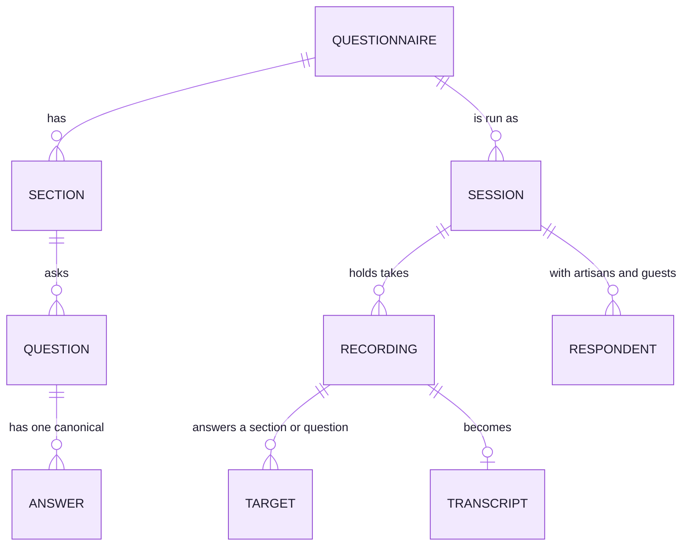

| | |
|---|---|
| Sessions and takes | A session is one sitting; each take is a recording aimed at a section or a question |
| Coverage | Computed from the takes and answers, never typed; each coverage cell lists its recordings |
| Canonical answers | One answer per question per artisan, with revisions and machine-suggested labels |
| Chips | Every recording carries chips in a fixed order: targets, questionnaire, people, date, captured, workshop, language, duration |
| Filters | The same chips filter sessions and recordings on every surface, searched on the server as you type |
| Offline | Takes stay on the phone in the outbox until they upload; a session started offline syncs whole |

<picture>
  <source media="(prefers-color-scheme: dark)" srcset="docs/readme-kit/assets/divider-dark.svg">
  
</picture>

## &nbsp; Data, exports and the field app

| Capability | Web | Android | How |
|---|:---:|:---:|---|
| Capture every record type with media and GPS | ✓ | ✓ | one form contract per record, shared as JSON |
| Save without signal, sync later | ✓ | ✓ | an outbox (IndexedDB on the web, on-disk on the phone) replayed with idempotency keys |
| Dictate into any prose field | ✓ | ✓ | on Android the phone's on-device speech pack is tried first |
| Scan an artisan card | ✓ | ✓ | a signed QR; ML Kit on the phone |
| Transcript viewer, edits and downloads | ✓ | ✓ | the shared transcript contract |
| Summary edit and regenerate, Refine | ✓ | ✓ | the same routes and wording |
| Data browser and report workbooks | ✓ | ✓ | `GET /api/data/*` |
| Coverage map with zoom | ✓ | ✓ | per-district counts |

- **Data browser** (`/data`): the folder tree with search as its toolbar and every download in one
  panel, with sizes shown first, several folders or files picked together, previews, thumbnails and
  every transcript format in one zip. Zips stream to disk in a background worker and keep going in a
  hidden tab; Save to a folder resumes. Removed recordings never ship, and the dataset download
  includes every review status. Table search runs over every row on the server and any sheet
  downloads as `.csv`; tables are remembered per folder. The report workbook is built one at a time,
  and the box hands the memory back afterwards (launch list D39). See
  [DATA_EXPLORER.md](docs/DATA_EXPLORER.md) and [DATA_EXPLORER_WEB.md](docs/DATA_EXPLORER_WEB.md).
- **Android data browser**: the *Data* screen puts the tree first with search as its toolbar and one
  *Download* button. Zips run in the background with a notification and Cancel, and keep going when the
  app is left ([Play declaration](docs/ANDROID_BACKGROUND_DOWNLOADS.md)).
- **Dataset API** (`/api/datasets`): for machines, behind admin credentials. Streams NDJSON or CSV
  with no row cap, keyset-paged, and sends `X-Dataset-Total` so a client can prove a download is
  complete. Artisan identity numbers are masked by default.
- **Crafts**: 455 crafts in 9 categories and 36 sub-categories, 209 of them GI-tagged, identical in
  both portals and served from `GET /crafts/catalogue` with an `ETag`.
- **For the Ministry**: the craft list is the Ministry of Textiles' own (Annexure I), and this portal
  can feed per-district aggregate counts (no ids, no names) to the designer portal's Ministry coverage
  map through a signed peer route, switched on by `CROSS_PORTAL_COVERAGE_ENABLED` on both servers.
  Artisan identity links and one search across both portals are built the same way, each behind its
  own switch.

<picture>
  <source media="(prefers-color-scheme: dark)" srcset="docs/readme-kit/assets/divider-dark.svg">
  
</picture>

## &nbsp; Server, releases and safety

<picture>
  <source media="(prefers-color-scheme: dark)" srcset="docs/readme-kit/assets/cards-ops-dark.svg">
  
</picture>

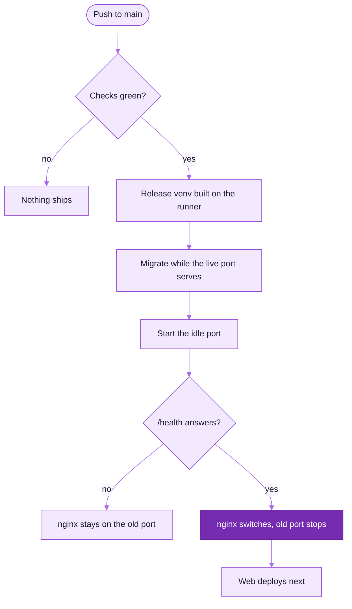

| Server | Value |
|---|---|
| Box | one EC2 `t3.small` (2 vCPU, 2 GiB) on Ubuntu 26.04, encrypted gp3 root |
| Interpreter | upstream CPython 3.15.2 from a checksum-pinned python-build-standalone build, the release CI tests |
| Releases | blue/green on ports 8000 and 8001 behind nginx; `backend/deploy/blue_green.sh rollback` goes back |
| Release venv | built on the GitHub runner and named after the interpreter, the lock and the schema; a code-only release ships none |
| Prisma | `prisma.types` loads lazily (`backend/app/prisma_lazy_types.py`), so neither process imports 28 MB of TypedDicts at start; migrations run through `python -m app.prisma_cli` |
| Memory | API 211 MB + query engine 42 MB, worker 130 MB + 24 MB (PSS); 785 MB of 1.9 GB used, 56 MB of swap (measured 4 Nov 2026) |
| Work files | transcription temp files live in one capped directory (`backend/app/transcription/workdir.py`, 2 GiB, stale after 3 h) and are cleaned up |
| Queries | list pages and the Data page were rewritten to load what they show; report builds are serialised behind a semaphore |
| Backups | `pg_dump` to S3 every night at 03:17 IST, a weekly copy kept for a year, and a freshness check every afternoon that fails loudly |

| Safety | |
|---|---|
| Sign-in | Google, Microsoft, Yahoo or a password; an access roster decides who may enter |
| Two-step | TOTP with recovery codes; secrets sealed with `TWO_FACTOR_ENCRYPTION_KEY`, backed up in SSM |
| Roles | six tiers, enforced on the server; the clients only mirror them |
| Aadhaar | never stored: an HMAC fingerprint, shared with the designer portal, finds duplicates |
| Database | Supabase with RLS on every table and the anon role revoked; the API is the only door |
| Origin | the box answers CloudFront alone (`X-Origin-Verify` plus a prefix-list security group); SSH opens per deploy for one runner |
| Consent | one consent ledger; every external AI send re-reads it |

<picture>
  <source media="(prefers-color-scheme: dark)" srcset="docs/readme-kit/assets/divider-dark.svg">
  
</picture>

## &nbsp; Built with

<p align="center">
  <picture>
    <source media="(prefers-color-scheme: dark)" srcset="https://skillicons.dev/icons?i=nextjs,react,ts,tailwind,py,fastapi,postgres,prisma,kotlin,androidstudio,aws,terraform,nginx,githubactions,vercel&theme=dark&perline=15">
    
  </picture>
</p>

## &nbsp; Quick start

Tests and builds run on GitHub Actions; this is for a developer who wants the stack on their own
machine. The full reference is [ENVIRONMENT.md](docs/ENVIRONMENT.md) and [DOCKER.md](docs/DOCKER.md).

1. Start Postgres 17 (on host port `55432`) and the S3 stand-in (`9000`, console `9001`):

   ```sh
   docker compose up -d
   ```

2. Run the API on CPython 3.15 (on Windows, leave `uvloop` out of the lock first):

   ```sh
   cd backend
   cp .env.example .env
   python3.15 -m venv .venv && . .venv/bin/activate
   pip install -r requirements.lock && pip install --no-deps -e .
   python -m prisma generate --schema=prisma/schema.prisma
   python -m app.prisma_cli migrate deploy --schema=prisma/schema.prisma
   python scripts/seed_admin.py
   uvicorn app.main:app --reload --port 8000
   ```

   `ADMIN_PASSWORD` has no default; the seed refuses to run without one. `BACKEND_EXPOSE_DOCS=true`
   opens `/docs` locally; it is off by default so a deployment does not publish its schema.

3. Run the web app on Node 26:

   ```sh
   cd frontend
   cp .env.local.example .env.local
   npm install
   npm run dev
   ```

   `NEXT_PUBLIC_API_URL` is the API's origin only; `lib/api.ts` adds `/api` itself.

4. Open the `android/` folder in Android Studio, or point a build at your machine with
   `apiBaseUrl=http://10.0.2.2:8000/api/` in `android/local.properties`. The release build talks to
   `https://d2b34i3e92al6i.cloudfront.net/api/`.

## &nbsp; Documentation

[docs/README.md](docs/README.md) is the index. The ones people reach for first:

| Question | Read |
|---|---|
| How do I hand the app to a researcher? | [RESEARCHER_GUIDE.md](docs/RESEARCHER_GUIDE.md) |
| What does each screen ask for? | [WALKTHROUGH.md](docs/WALKTHROUGH.md) |
| How does the system fit together? | [ARCHITECTURE.md](docs/ARCHITECTURE.md) |
| How does a recording become English? | [TRANSCRIPT_PIPELINE.md](docs/TRANSCRIPT_PIPELINE.md) |
| Which AI features exist, and what do they cost? | [AI_FEATURES.md](docs/AI_FEATURES.md) |
| What is stored? | [DATA_MODEL.md](docs/DATA_MODEL.md) |
| Who may do what? | [PERMISSIONS.md](docs/PERMISSIONS.md) |
| How is it secured? | [SECURITY.md](docs/SECURITY.md) |
| Every environment variable | [ENVIRONMENT.md](docs/ENVIRONMENT.md) |
| How does CI gate a release? | [CI.md](docs/CI.md) |
| How is the Android app released? | [RELEASING.md](docs/RELEASING.md) |
| How is the API box deployed? | [backend/DEPLOY_AWS.md](backend/DEPLOY_AWS.md) |
| Counts: models, endpoints, tests | [REPO_FACTS.md](docs/REPO_FACTS.md), generated |
| How are these READMEs built? | [readme-kit/README_STYLE.md](docs/readme-kit/README_STYLE.md) |

## &nbsp; Status

<picture>
  <source media="(prefers-color-scheme: dark)" srcset="docs/readme-kit/assets/timeline-dark.svg">
  
</picture>

| Release | Android code | What it brought |
|---|---:|---|
| 0.0.1 | 22 | Version line reset, carrying what shipped as 0.0.20: the 455-craft master list, consent opt-out, coverage on Android |
| 0.0.2 | 23 | Query optimisation; questionnaire phases 1 and 2; author-or-admin form edits |
| 0.0.3 | 24 | One shared questionnaire engine; Questionnaire v2 switched on |
| 0.0.4 | 25 | Recording chips and filters; the transcript viewer's first cut |
| 0.0.5 | 26 | Scribe v2 + Gemini 3.8 Flash pipeline, Ask, autodraft, glossary, quote cards, budget |
| 0.0.6 | 27 | Karaoke, reading mode, marks, auto-follow; transcripts in View and Download data |
| 0.0.7 | 28 | Latest stable everything: Python 3.15.2, Node 26, Next 16.4, AGP 9.5 |
| 0.0.8 | · | Backend only: Terraform provider 6.71, Dependabot scanning restored |
| 0.0.9 | 29 | Old transcripts translated, declined English pasted by hand (D38); Data page reports (D39) |
| 0.0.10 | 30 | Video transcription, the upload choice, admin switches, Refine on web and Android, summary edits on Android, Gemini-first defaults, no comments in code |

Every code file in this repository is comment-free: `scripts/tools/strip_comments.py --check` runs in
Checks, and the reasons that used to live in comments live in [docs/](docs/README.md).

<picture>
  <source media="(prefers-color-scheme: dark)" srcset="docs/readme-kit/assets/footer-dark.svg">
  
</picture>

## How this document is kept true

This file orients; [docs/](docs/README.md) is the authority. When the two disagree, `docs/` wins and
this file is the one to fix.

| Claim class | Kept true by |
|---|---|
| Every link and repository path | `node docs/tools/check-docs.mjs` resolves them |
| The images, the diagrams and the rendered page | `readme-check.yml`: the kit rebuilds byte for byte, every mermaid block renders, GitHub's render keeps every `<picture>` |
| The words inside the SVGs | `docs/readme-kit/kit.json`; never hand-edit `docs/readme-kit/assets/` |
| Counts that change with the code | not stated here; [REPO_FACTS.md](docs/REPO_FACTS.md) is generated |
| The transcript features and models | [TRANSCRIPT_PIPELINE.md](docs/TRANSCRIPT_PIPELINE.md) and `shared/transcript-contract.json`, checked by `backend/tests/test_transcript_contract.py` |
| The questionnaire features | `shared/questionnaire-features.json`, checked on all four clients |
| The release table | `android/app/build.gradle.kts` (`appVersionName`, `appVersionCode`) and the `v*` tags |
| Server sizes and memory | read from `infra/terraform/main.tf` and the box on the dates given; re-measure after a resize |

**Review triggers:** a release, a new feature area, a change of model or provider default, a change
to the box or the deploy, or a new top-level directory.
