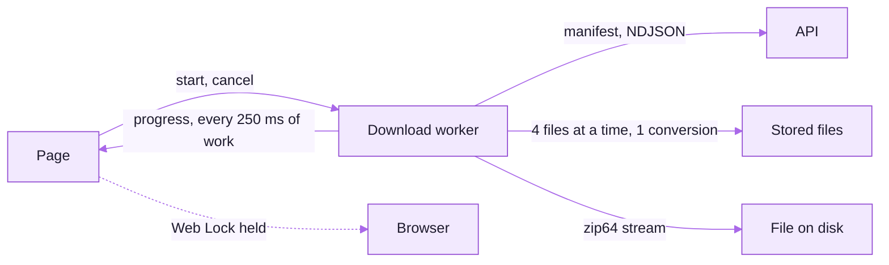

# Data explorer on the web (0.0.12)

The `/data` page in both portals is one shared client: `frontend/lib/dataExplorer/**` and
`frontend/components/dataExplorer/**`, byte-identical, edited in designer-portal and copied with
`python scripts/sync_data_explorer.py --to ../documentation-portal`. The page file in each portal only
supplies what differs (the review-status filter in the documentation portal, the design-workshop notes
in the designer portal, the record links). Proposal and owner decisions:
`C:/dev/IIT/docs/data-explorer/PROPOSAL_2026-11-04.md`.

## Layout

| Place | What it holds |
|---|---|
| Left (top on a phone) | the folder tree, with search, Organise by and (documentation portal) Review status as its toolbar |
| Right, first | **Downloads**: this folder, the selection, the whole dataset, all transcript formats, with sizes before anything starts |
| Right, below | the record card, then **Files** or **Tables** |
| Under both | Browse by type (paged, searched on the server) and Transcripts |

The folder, view, sheet, table search, browse type, page and search live in the URL, so Back works and a
folder can be shared as a link. The scroll position is kept per URL in the tab's session storage.

## Downloads keep going in a background tab

- The whole pipeline (listing, fetching, zipping, writing) runs in a dedicated Web Worker. Nothing is
  paced by a timer or by `requestAnimationFrame`, so a hidden tab does not slow it. While the tab is
  hidden the page keeps the latest progress and draws it when the tab comes back.
- Chromium writes straight to the file the person chose (File System Access), so a 7 GB zip never sits
  in memory. Firefox hands the stream to the browser's own download manager through
  `public/download-stream-sw.js`. Other browsers build the zip in the worker up to a limit (Safari 1 GB,
  iOS 512 MB) and say so before starting.
- A shared Web Lock (`data-explorer-download`) is held for the whole job, so Chrome does not freeze the tab.
- A single file, a transcript in every format (`format=zip`) and a folder's transcripts
  (`/data/transcript-bundle`) go straight to the browser's download manager.
- Each file is tried three times and resumed with a `Range` request. A file that still fails is left out
  of the zip (a half-written entry is kept out of the zip's directory) and listed in
  `_failed-downloads.txt` and on screen. Audio converted to `.mp4` that the server answers with
  `X-Conversion: original` is saved under its real name.
- The engine reads 408 and 429 as worth another try and any other 4xx as final itself, because it runs in
  the worker and must not import the page-side failure table; `failure-triage-unit.spec.ts` lists it.
- **Save to a folder** writes each file on its own and keeps `.download-progress.json` in the folder
  until the job finishes, so running it again into the same folder skips what is already there.
- Cancel stops the worker at once; leaving the page mid-way asks first.

## Tables

Subfolder tables load on their own; the repository root still loads on click. Each answer is kept in
memory and in session storage per folder, review status and viewer (16 folders, 24 MB, 10 minutes), so
going back costs no request. The search box searches every row on the server (`q`); against an older
server it searches the 200 rows shown and says so. Each sheet has a CSV. A busy report reads
"Busy, retrying in 60 s" and retries once.

## How this document is kept true

| Claim | Kept true by |
|---|---|
| The shared trees are identical in both portals | `data-explorer-web-imports-unit.spec.ts`, `shared/data-explorer-web.sha256` |
| Zip64, resume, the failed list, 4 + 1 concurrency, folder resume | `data-explorer-engine-unit.spec.ts` |
| Bytes still arrive with the tab hidden, under a held Web Lock | `data-explorer.spec.ts` |
| The layout at three sizes in both themes | `data-explorer.spec.ts` (screenshots in the run's artefact) |

## The tests

| Spec | What it holds |
|---|---|
| `frontend/e2e/data-explorer-engine-unit.spec.ts` | zip and zip64 records, resume, the failed list, 4 + 1 concurrency, streaming without holding a file, folder resume, selection, URL state, table memory, one request per file |
| `frontend/e2e/data-explorer.spec.ts` | the layout on desktop, tablet and phone in light and dark, the tree keyboard, downloads to disk, bytes still arriving with the tab hidden, Cancel, previews, thumbnails, table search, browse paging, languages |
| `frontend/e2e/data-explorer-web-imports-unit.spec.ts` | the shared trees import only what both portals carry, and match the other portal |

Feature ids for the parity registry are `X1`–`X12` (`shared/data-explorer-contract.json`); the web
tests carry `@qf:<id>`.
