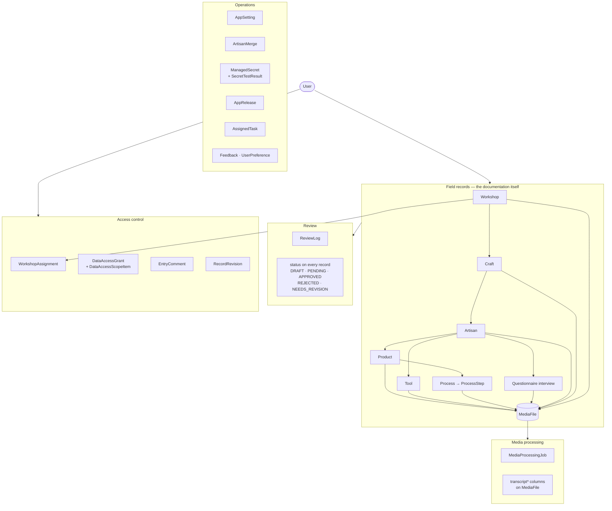
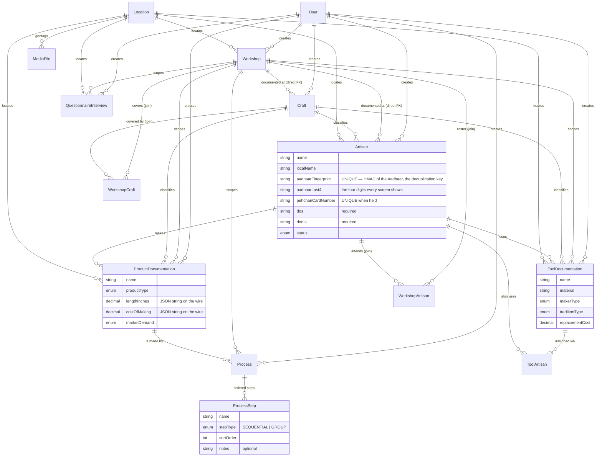
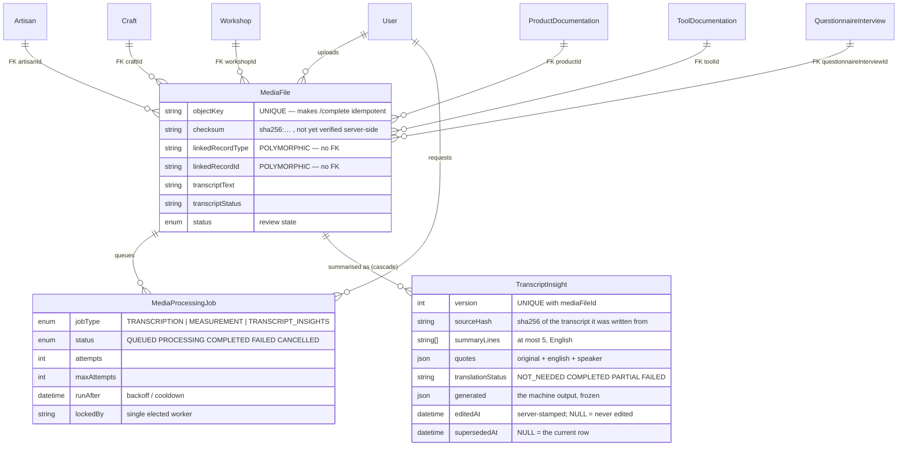
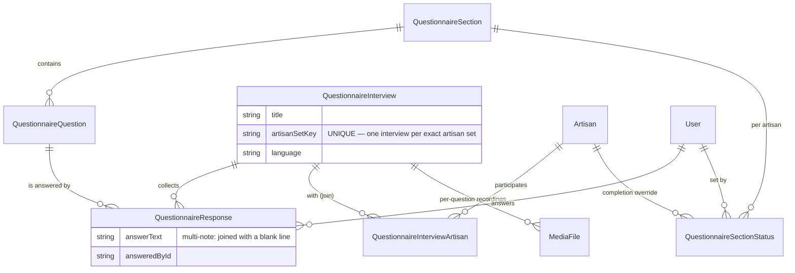
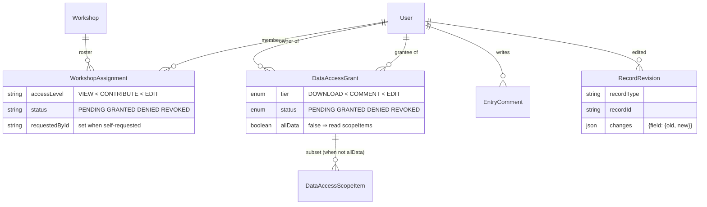

# The data model

The shape of everything the repository stores, why each relationship exists, and the four places
where the schema does something a reader would not predict from the field names.

Source of truth is `backend/prisma/schema.prisma` — a single file, heavily commented, and the only
definition of the database. Model and enum **counts** are not written here; they are generated into
[REPO_FACTS.md](REPO_FACTS.md), because a count in prose is wrong the first time anyone adds a table.

Sister documents: [ARCHITECTURE.md](ARCHITECTURE.md) for how requests reach these tables,
[PERMISSIONS.md](PERMISSIONS.md) for who may write to them, [SCALABILITY.md](SCALABILITY.md) for what
the indexes are for.

---

## 1. The one-line shape

**Workshop → Craft → Artisan → { Product → Process → ProcessStep, Tool, Questionnaire } → Media.**

Everything else in the schema is one of four supporting systems: review, media processing, access
control, or operations (settings, secrets, releases, tasks, feedback).



Read that as: a `User` is the author of everything in `core`; `acl` decides which users may see or
change another user's rows; `review` and `proc` are state machines that run *over* core records
rather than beside them.

---

## 2. Field records

The tables a researcher actually fills in. Attribute lists below are the load-bearing columns, not
every column — the schema has the full list with a comment on each non-obvious one.



### 2.1 Workshop is linked twice, on purpose

`Craft` and `Artisan` each carry **both** a direct `workshopId` column and a row in the
`WorkshopCraft` / `WorkshopArtisan` join table. That is not redundancy left behind by a migration.
The join answers "which crafts did this workshop cover", which is many-to-many and always was; the
direct column answers "which workshop was this record *documented at*", which is single-valued and is
what every workshop-scoped permission check and every Data Browser folder reads. The two are written
in lock-step (`link_workshop_artisan` / `link_workshop_craft` in
`backend/app/services/workshop_access.py`), and the column is nullable so rows recorded before it
existed keep working.

### 2.2 One tool, many artisans

The same documented tool recurs across crafts. `ToolArtisan` exists so it is entered once and then
assigned, rather than re-entered per craft — which is also why `ToolDocumentation` keeps its own
single `artisanId` (the artisan it was *documented with*) alongside the join.

### 2.3 Decimals are strings on the wire

Every `Decimal` column — measurements, costs, prices — is serialised by the API as a **JSON string**,
not a number. Clients must type them as strings. This has emptied a dropdown twice by being
forgotten; see the note in [ARCHITECTURE.md](ARCHITECTURE.md).

### 2.4 `Location` is two answers to two different questions

The largest comment in the schema is on this model, and it is worth reading in full. Briefly:

| Group | Columns | Means | Written by |
|---|---|---|---|
| **Provenance** | `latitude`, `longitude`, `altitude`, `accuracy`, `capturedAt`, `placeName`, `address` | where the **device** was when the record was typed | automatically, by the capture UI |
| **Stated address** | `state`, `district`, `village`, `pincode`, `subjectLatitude`, `subjectLongitude` | where the **subject** is, as a statement by the researcher | only ever by a person |

The split exists because every artisan on the live database with a location sits within a few hundred
metres of one point in Kharagpur, West Bengal, while the places their researchers typed are Bagru,
Balotra, Kutch, Rudraprayag, Ballupur, Sanganer and Kappaladoddi. The coordinates are not wrong —
they are genuine GPS fixes, with real accuracy values, **of the desk the record was typed at**. The
schema previously had nowhere to say that, so the fix got read as the artisan's address. Nothing was
backfilled; the mismatch is flagged in the form rather than guessed at in the database.

> **In flux.** The geocoding service (`backend/app/services/address.py`), the reference endpoint and
> both clients' `LocationFields` are being changed by another workstream as this is written. The
> table above is the schema's shape, which is settled; the UI wording around it may not match yet.

---

### The artisan form contract (2026-10-17)

One artisan form in both portals, on the web and on Android (owner decision): the designer portal
adopted the documentation portal's form. `shared/artisan-form-contract.json` declares it and is
byte-identical in the two repositories; `backend/tests/test_artisan_form_contract.py` holds each
client's form to it and compares the two repositories when both checkouts are present.

- **Date of birth** and **Craft start date** (`Artisan.dateOfBirth`, `Artisan.craftStartDate`) are
  **required on every new save** — a create, and an edit made from the artisan form. The columns stay
  nullable.
- **Experience** is two optional boxes, *Experience (years)* (`experienceYears`, 0–90) and
  *Experience (months)* (`experienceMonths`, 0–11, a remainder, `CHECK` on the column). The months
  box's empty option is *Not stated* and stores NULL, never 0. Both portals already stored experience
  this way, so the contract needed **no migration**.
- **Server-side:** a save carrying `"formContract": 2` in its body is refused with a 422
  ("Enter the date of birth and the craft start date.", naming only what is missing) when a date
  would be empty; on an edit the stored value counts for a date the body leaves out, an explicit null
  does not. Every current web and Android save sends the key.
- **Transition:** a body **without** `formContract` is the old shape and is accepted unchanged — an
  outbox entry queued by an older build (web IndexedDB or the Android outbox, both of which store the
  body at queue time), the spreadsheet import and a review-queue edit. Removing that acceptance is a
  later change, once no older build is in the field.
- **Records saved before the rule** still load and display: the date boxes open empty and the months
  box reads *Not stated*. An edit of such a record from the artisan form asks for both dates before
  it saves.

### Web capture fields (2026-10-17)

Three additive columns (migration `20261020121500_web_capture_fields`), each NULL or false on every
row that already existed, so nothing changes until a client uses them:

- **`Artisan.aadhaarNotShared`** — the explicit outcome *Not shared by artisan* (owner decision C18).
  It is the only way a NEW artisan is saved without an Aadhaar number (`ArtisanCreate` refuses a
  create that has neither), and it flags the record for follow-up: `GET /artisans?aadhaarNotShared=true`
  lists them. Adding a number clears it. An empty box is never the outcome.
- **`QuestionnaireQuestion.artisanField`** — which artisan field answers the question in an interview
  (`name`, `place`, `craft`, … and the sitting facts `interviewDate`, `interviewer`; the closed list is
  `ARTISAN_FIELD_KEYS` in `backend/app/schemas/questionnaire.py`). Set in the question builder.
- **`QuestionnaireResponse.answerSource`** — `TRANSCRIPT` when the answer was taken from the
  question's own transcribed clip ("Use as answer"); NULL for a typed answer, and set back to NULL by
  a later save that changes the words (a notes-only change keeps it).
  `POST /questionnaire/interviews/{id}/apply-transcripts` fills every EMPTY answer of a sitting this
  way in one call, never touches a typed one, needs Researcher or review access, and runs the same
  edit gate as a PATCH (a revision row, the resubmit and late-submission status rules).

Two rules changed without a column: a linked product's `craftName`, `artisanName` and `place` are
filled by the server from the linked artisan and craft (`services/linked_names.py`), so the typed
copies are required only for an unlinked product (a linked create whose records cannot supply a
name is refused, and on an edit only a CHANGED link re-derives them); and a process step may be saved without a name
(it is shown as *Unnamed step* until somebody names it). An interview created without a title is
named "<artisan> · <questionnaire> · <17 Oct>" by the server.

### Record completeness (2026-10-18)

Every artisan, product, tool, interview and workshop the API returns carries a `completeness` block:
which of the fields a complete record holds are still empty. It is computed on read. There is no
column, no migration and nothing stored, and no `RecordRevision` is written.

- **One table.** `shared/record-completeness.json` names the fields per kind and how each is
  checked (`present`, `notIn`, `anyPresent`, `count`). It is byte-identical in both portals. It is
  committed four times in this repository and the copies are held equal by
  `backend/tests/test_record_completeness.py`: `shared/`, `backend/app/services/` (what the server
  loads; the deploy ships `backend/` only), `frontend/lib/generated/` and
  `android/app/src/main/assets/`.
- **The block.** `{rulesVersion, filled, total, percent, requiredMissing, missing: [{key, label,
  words, level}]}`. It carries field names only, never values. `percent` is floored, as in the
  designer portal, so 100 means complete.
- **Sentence.** `N field(s) left: ` and the first three `words`, then `, +K more`. Required items
  come first, then file order. At nothing missing the sentence is `Complete`.
- **Required means the form refuses without it.** The artisan's `required` items are the two dates of
  the artisan form contract (read from the column only, like `missing_required_dates`), the craft,
  Do's and Don'ts. The meter reports and enforces nothing. The artisans saved before 2026-10-17
  without a date (29 on the live repository) are the ones listed under *Missing required*.
- **What it never covers.** No prose (rich-text) column, because an empty editor document is not an
  empty string and the list filter could not agree with the meter. No Aadhaar, Pehchan, phone,
  email, address or gender: these are recorded only with the artisan's consent.
- **Counts.** Photos are `MediaFile` rows of type `IMAGE` that are not `REJECTED`. Recordings are
  `AUDIO`/`VIDEO`. Workshop artisans and crafts count through either link (join rows or the
  record's own `workshopId`). `services/completeness.attach` counts from a relation the route has
  already loaded and reads every other source in one grouped query for the whole page, through
  the route's own Prisma client. If a count cannot be read, the record goes out without a block
  (a save that already landed never answers 500) and the clients use their own evaluator.
- **Filter.** `GET /artisans`, `/products`, `/tools`, `/workshops` and `/questionnaire/interviews`
  accept `completeness=incomplete|required|complete` (anything else is 422). The clause comes from
  the same table (`missing_where`) and is AND-combined with the other filters. The test checks that
  the filter and the meter agree row for row. One edge is accepted: a string holding only
  whitespace reads as missing to the meter and as filled to SQL, and no form writes one.
- **Rules endpoint.** `GET /records/completeness-rules` returns the file with an `ETag`
  (`"<version>-<sha256 first 8>"`, exposed to the browser through CORS) and answers `304` to a
  matching `If-None-Match`. The web keeps the answer in `localStorage`; Android keeps it in the OkHttp
  disk cache and a `filesDir` copy. Both start from their bundled copy and switch to the server's only
  when its `version` is higher, so the meter works offline and on outbox drafts.
- **Not in scope.** Processes, crafts and media have no rules. Exports and the cross-portal feed
  carry no completeness.

## 3. Media, and the polymorphic link

`MediaFile` is the one table almost everything points at, and it uses **two different linking
mechanisms** — which is the single most confusing thing in the schema if you meet it by accident.



**Six parents are real foreign keys.** Artisan, craft, workshop, product, tool and questionnaire
interview each have a nullable column on `MediaFile`, with `onDelete: SetNull` — deleting a product
orphans its photographs rather than destroying them.

**Process and process-step media are not.** There is no `processId` or `processStepId` column on
`MediaFile`. Those attachments are carried by the polymorphic pair `linkedRecordType` +
`linkedRecordId` (`"process"`, `"processstep"`), as `backend/app/api/routes/processes.py` says
explicitly. Anything that walks media by parent must handle both mechanisms — the Data Browser and
the XLSX export both do, via their `_MEDIA_TAG_SLOTS` / `_OWNER_TAGS` lists.

> If you are drawing this relationship for a paper, draw it as two mechanisms. Earlier versions of
> `ARCHITECTURE.md` drew `ProcessStep ||--o{ MediaFile` as an ordinary relation; there is no such
> relation in the database, and a reader who trusts it will write a join that cannot be written.

**`TranscriptInsight` is one row per generation run** (2026-10-18). A summary, key quotes and an
English translation of the transcript, with provider, model and prompt version on the row. A
regeneration never overwrites: it stamps the previous row's `supersededAt` and adds `version` + 1,
so the current insight is the row with `supersededAt` NULL. A researcher's edit changes only that row
and stamps `editedAt`/`editedById` (no relation, like `transcriptEditedById`); `generated` keeps what
the model wrote. Deleting the media deletes its insights. **`MediaFile.transcriptSummary` is not a
summary** — it holds the raw provider text under a refined transcript — and nothing writes insights
into it. See [AI_FEATURES.md](AI_FEATURES.md) §10.

`linkedRecordType`/`linkedRecordId` is also how Miscellaneous Media attaches to anything at all, and
how `EntryComment` and `RecordRevision` address a record without one FK per table.

---

## 4. Questionnaire



Three things here that are not obvious:

- **`artisanSetKey` is unique.** There is exactly one interview per *exact* set of artisans. Saving
  answers for a set that already has an interview folds into it rather than creating a second one —
  which is why `POST /questionnaire/interviews` is the one route that cannot decide from its
  signature whether it is a create (see `assert_can_create_records`).
- **Completion is derived, then overridden.** The artisans × sections matrix is computed from the
  responses that exist; `QuestionnaireSectionStatus` stores an *admin override* on top, for the
  legitimate case of a section that will never be answered.
- **A response belongs to its answerer.** `answeredById` is why a question already answered by
  somebody else cannot be silently overwritten by the next contributor.

---

## 5. Access control

Three separate systems, deliberately not merged, because they answer three different questions.



| System | Question it answers | Granted by |
|---|---|---|
| Role (`User.role`) | what *kind* of thing may you do at all | a professor or admin, on the Users page |
| `WorkshopAssignment` | may you work **in this workshop** | an admin — either by assigning, or by deciding a user's own request |
| `DataAccessGrant` | may you see **another researcher's** records | that researcher, the record owner |

`WorkshopAssignment` and `DataAccessGrant` are both two-sided: a row can start as an admin's grant or
as the subject's own request (`requestedById` distinguishes them), and a refusal is kept as `DENIED`
rather than deleted, so nobody can re-request their way quietly around a "no".

`RecordRevision` is append-only and stores `{field: {old, new}}`, which is what lets an admin
reconstruct a record's original values after a cross-researcher edit. It is written on the contribute
path, so an edit that goes through the normal PATCH is captured; a direct database write is not.

---

## 6. Operations

| Model | Holds | Notes |
|---|---|---|
| `AppSetting` | repository-wide settings | includes `transcriptionMode` (`RAW`/`REFINED`/`REFINED_TRANSLATED`), the STT provider order, and the nightly workshop filing (`workshopAutoMap*`: on/off, the night's claim, what the last run filed — `services/workshop_auto_map.py`) |
| `ArtisanMerge` | one merge of two artisan records that were the same person | the audit row, the undo (every column of the merged row, the survivor before and after, the id of every re-pointed row; undoable for 30 days, identity numbers masked after) and the redirect for queued writes that still name the merged id. No foreign keys, by design — `services/artisan_merge.py` |
| `ManagedSecret` | runtime-editable provider keys | value is **Fernet-encrypted at rest**; never returned in full, only a masked preview |
| `SecretTestResult` | the last reachability check per key | so "is this key working" has an answer that is not a guess |
| `AppRelease` | published Android APKs | the OTA channel; `versionCode` is what devices compare |
| `AssignedTask` | one row per assignee | a batch of five researchers is five rows sharing a `batchId` |
| `Feedback`, `UserPreference` | one row per user each | `UserPreference.weeklyDigest` is the Monday summary's opt-out (default on) |
| `WeeklyDigest` | one row per person per reported week | the Monday summary's ledger (`services/weekly_digest.py`): unique `(userId, weekStart)` is the idempotency key; `status` PENDING → DELIVERED, SKIPPED_EMPTY or SKIPPED_OPTOUT; `payload` is counts and app paths only; purged after 26 weeks |
| `ReviewLog` | one row per review decision | append-only; an edit-then-approve writes two rows |
| `TwoFactorChallenge` | one row per sign-in waiting for its authenticator code | keyed by the challenge token's `jti`; counts attempts (five, then dead), deleted by a correct code, swept when expired. The account's own two-step columns (`User.twoFactor*`: the encrypted secret and pending secret, hashed recovery codes, the last accepted time step, and the per-account failure budget and lock) are in [SECURITY.md §3.3B](SECURITY.md) |

---

## 7. Enums

Every enum, and the thing to know about each. The list of names is generated into
[REPO_FACTS.md](REPO_FACTS.md); this is what they *mean*.

| Enum | Values | Note |
|---|---|---|
| `UserRole` | the six tiers | strictly ordered — see [PERMISSIONS.md](PERMISSIONS.md) |
| `AuthProvider` | `LOCAL`, `GOOGLE` | a Google account has no password hash at all |
| `RecordStatus` | `DRAFT`, `PENDING`, `APPROVED`, `REJECTED`, `NEEDS_REVISION` | `NEEDS_REVISION` is the "sent back with comments" state |
| `ReviewRecordType` | artisan, workshop, product, tool, process, questionnaire, media | processes and interviews are reviewable because the late-submission gate can pin them `PENDING` |
| `MediaType` | image, video, audio, pdf, document, other | |
| `MediaProcessingJobType` | `TRANSCRIPTION`, `MEASUREMENT`, `TRANSCRIPT_INSIGHTS` | insights jobs are drained only while their AI flag is on, and never load the audio |
| `MediaProcessingJobStatus` | queued, processing, completed, failed, cancelled | a throttled job returns to `QUEUED` **without** spending an attempt |
| `ProcessStepType` | `SEQUENTIAL`, `GROUP` | ordered stage versus things done together |
| `DataAccessTier` | `DOWNLOAD` < `COMMENT` < `EDIT` | ordered; each includes the ones below |
| `DataAccessStatus` | pending, granted, denied, revoked | only `GRANTED` confers anything |
| `ProductType`, `MarketDemand`, `MakerType`, `TraditionType` | field vocabularies | |

Note that two ordered ladders — `WorkshopAssignment.accessLevel` and `AssignedTask.status` — are
**plain `String` columns, not enums**, for client compatibility. Treat them as enums in code; the
database will not.

---

## How this document is kept true

| Claim class | Kept true by |
|---|---|
| Model and enum counts, index counts, the model list | Generated. `node docs/tools/check-docs.mjs --write` rewrites [REPO_FACTS.md](REPO_FACTS.md); the check fails if it is stale. No count appears in this file. |
| The relationships in every `erDiagram` | Hand-written against `backend/prisma/schema.prisma`. Re-derive with the one-liner below and diff the result against §2–§5. |
| Column semantics and the four surprises (§2.1, §2.3, §2.4, §3) | The schema comments. Each is quoted from a comment that lives next to the column; if the comment and this file disagree, the schema wins and this file is wrong. |
| Paths and line references | `node docs/tools/check-docs.mjs` resolves every path mentioned here. |

Re-derive the relation graph after any migration:

```bash
python - <<'EOF'
import re
src = open('backend/prisma/schema.prisma', encoding='utf-8').read()
models = re.findall(r'^model (\w+) \{(.*?)^\}', src, re.S | re.M)
names = {n for n, _ in models}
for name, body in models:
    rels = [f"{m[1]}:{m[2]}" for line in body.splitlines()
            if (m := re.match(r'\s*(\w+)\s+(\w+)(\[\])?\??\s', line + ' ')) and m[2] in names]
    print(f"{name}: {', '.join(rels) or '-'}")
EOF
```

**Review trigger:** any file under `backend/prisma/migrations/`. A new migration means this document
needs a human read, not just a regenerated count — a new column is a fact, but what the column
*means* is the part only a person can write.

## Duplicate artisans and merges — added 2026-10-18

| Model | Holds | Notes |
|---|---|---|
| `ArtisanDuplicateCandidate` | one likely pair (`kind = WITHIN`), `artisanAId < artisanBId` | `score`, `band` (`POSSIBLE` 0.60, `LIKELY` 0.75, `VERY_LIKELY` 0.90) and `reasons` as codes, never values. `status` `OPEN` / `NOT_DUPLICATE`; a dismissed pair stays dismissed through every re-scan. `creatorSaidDifferent` is set when the person saving answered "Different person". Rows cascade away with either artisan. |
| `ArtisanMerge` | one merge, forever | `mergedId` (unique among live merges: a partial index on `undoneAt IS NULL`, so an undone pair can be merged again) → `survivorId` is the redirect: `GET /artisans/{mergedId}` answers 404 `artisan_merged` with the survivor, and every write that names a merged id lands on the survivor. `snapshot` (the deleted row, its consent and every collision row), `moves` (each re-pointed primary key) and `choices` make the merge reversible until `undoUntil` (30 days); the worker then clears `snapshot`, `moves` and `crossPortal` and stamps `snapshotPurgedAt`. |

A merge re-points every row that names the deleted artisan, listed in `MERGE_REPOINT`
(`services/artisan_merge.py`); `test_artisan_merge_registry.py` fails when a table that points at
`Artisan` is missing from it. The newer `ArtisanSharingConsent` decision wins, and
`CrossPortalArtisanLink` rows move with the record. Field Repository never stores `CROSS_PORTAL`
pairs: the designer portal asks `POST /api/cross-portal/peer/artisans/match` and keeps the answer.

## The Aadhaar fingerprint — added 2026-10-17

**The register keeps no Aadhaar number.** `Artisan.aadhaarFingerprint` (HMAC-SHA256 of the 12 digits
under `AADHAAR_FINGERPRINT_KEY`, lower-case hex, `@unique`) is the deduplication key, and
`Artisan.aadhaarLast4` is what every surface shows as `XXXX XXXX 9012`. Both are written only by
`services/aadhaar_fingerprint.seal`, from the number a client typed, which is then dropped; CHECK
constraints hold them to 64 hex characters and four digits, and to "both or neither". The key and the
formula are the designer portal's, so the two registers can be matched (the cross-portal link). The
legacy `aadhaarNumber` column is written only to clear it, is read only to mask and match rows not
yet backfilled, and is dropped by the deferred migration — run order in `backend/DEPLOY_AWS.md`,
"Aadhaar fingerprint". The edit history (`RecordRevision`) records an Aadhaar change under
`aadhaarNumber` with no value; entries written before 2026-10-17 held real old and new numbers, are
served valueless from now on, and are rewritten by the backfill.

## Artisan cards — added 2026-10-21

**A printable card per artisan, with a QR that says nothing about them.** `ArtisanCard` holds one
row per card ever issued: `code` (10 Crockford base32 characters from `secrets`, `@unique`, never
derived from the artisan), the `keyVersion` of `ARTISAN_CARD_KEY` that signs its QR, and who issued
and revoked it. At most one card per artisan is live (`revokedAt` null), held by the partial unique
index `ArtisanCard_one_live_per_artisan` — raw SQL in `20261023090000_artisan_cards`, because Prisma
cannot declare it. A lost or damaged card is revoked with a reason (`LOST`, `DAMAGED`, `OTHER`), never
deleted, so its code answers "replaced" rather than "unknown". The QR and the short code are drawn on
every read (`backend/app/services/artisan_card.py`) and never stored.

`ArtisanCardEvent` is the log: every issue, reissue, print (with `count` for a bulk sheet), lookup,
miss and peer lookup, with the account and the source (`WEB`, `ANDROID`, `PEER`). `RESOLVE_MISS` rows
are also the per-account miss budget behind the 429.

`CrossPortalArtisanLink.remoteCardCode` (nullable, `@unique`) is the Design Prototype Workshop's live
card code for the linked record, pushed by that portal at link time and after a reissue. It is the only
way a designer card (issuer `D`) opens an artisan here; this server never calls the other one.

The card's cluster line is derived, not stored: `Location.village`, then `Location.district`, then
`Artisan.place`. The face carries the name, local name, craft, cluster, the photo (the artisan's first
image, switchable per print) and `aadhaarLast4` as `XXXX XXXX 9012` — never the fingerprint, phone,
address, date of birth or Pehchan number. Cards are issued by `backend/scripts/backfill_artisan_cards.py`
at deploy (dry run by default, `--apply` to write, idempotent) and lazily on first read.

