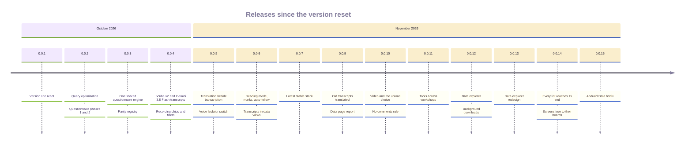

# Release runbook: data steps

The steps a release has to take on the production data, after the deploy has applied the migrations. The same page in both repositories. Each step names the release that introduced it.

## The releases

Both portals release together from a branch `release/<version>` of the same name, merged locally, with one deploy per platform. The Android version line was reset to 0.0.1 on 2026-10-21; the version code keeps rising and `publish-android.yml` refuses a code at or below the published one.

| Release | Date | DR code | FR code | What shipped |
|---|---|---:|---:|---|
| 0.0.1 | 2026-10-21 | 27 | 22 | The version line reset |
| 0.0.2 | 2026-10-22 | 28 | 23 | Query optimisation; questionnaire phases 1 and 2; a form's author may edit and delete it |
| 0.0.3 | 2026-10-22 | 29 | 24 | One shared questionnaire engine (`shared/questionnaire.sha256`), the parity registry `shared/questionnaire-features.json`, questionnaires v2 switched on |
| 0.0.4 | 2026-10-31 | 30 | 25 | The transcript pipeline: Scribe v2 turns, Gemini 3.8 Flash English, the viewer on web and Android, Ask, auto-draft, glossary, quote cards, the USD 100 monthly budget; recording chips and filters |
| 0.0.5 | 2026-11-01 | 31 | 26 | Translation beside transcription, the Gemini billing hold, admin-only cost and model names, speaker samples, copies without timestamps, the Voice Isolator switch (off) |
| 0.0.6 | 2026-11-01 | 32 | 27 | Transcript previews, reading mode, timeline marks and speaker colours, auto-follow, coverage dots, back navigation that restores the list, transcripts in View data and Download data, the sized transcription work directory (D37) |
| 0.0.7 | 2026-11-01 | 33 | 28 | The latest stable stack: Python 3.15.2, Node 26, Next.js 16.4, AGP 9.5, Gradle 9.8 |
| 0.0.8 | 2026-11-01 | · | · | `requires-python >=3.14` so Dependabot scans the backend; no app release |
| 0.0.9 | 2026-11-03 | 34 | 29 | Old transcripts queue their translation and a declined one takes a person's English (D38); the Data page report on a click (D39); the backup freshness check |
| 0.0.10 | 2026-11-04 | 35 | 30 | Video transcribed as its sound; the Transcribe and translate choice per file; admin auto switches; the backfill switch, off, with its cost estimate (D40); Gemini-first AI defaults with GPT-6 Luna and Claude Sonnet 5.5 only when selected; refine on every client; Android AI suggestions and summary edit; no comments in source, enforced in Checks; the README kit |
| 0.0.11 | 2026-11-04 | 36 | 31 | A tool linked to several artisans shows under every workshop those artisans belong to, in the data browser, reports and xlsx, folder zip, dataset bundle, tools filters, search and the datasets API; the tool sheet's Linked workshops column; web and Android tool rows name every linked artisan; no migration and no data step |
| 0.0.12 | 2026-11-05 | 37 | 32 | The data explorer in both portals and on every client: tree first with search as its toolbar and every download in one place; sizes before a download; multi-select; thumbnails and previews; table search over every row and a CSV per sheet; browse by type with pages; transcripts fetched on demand and all formats in one zip per transcript or folder; removed recordings never ship; audio streamed to `.mp4` with the original as fallback; web zips stream to disk in a worker and keep going in a hidden tab; Android zips run as a background data-sync job with a notification and Cancel; usage logging in FR; DR dictation allowance polled at most every 10 minutes; unified search finds a tool under every workshop its linked artisans belong to; migration `20261205090000_usage_event` in FR and `20261205090000_search_tool_workshops` (two search triggers) in DR; data step: `python -m scripts.search_reindex --type tools` once on each box |
| 0.0.13 | 2026-11-05 | 38 | 33 | The data explorer redesign in both portals and on every client: the report waits in a queue and is cached per folder, report options with remembered choices, saved views, new-since-you-looked counts, live report links, waveforms and clear voices, the workshop overview with section links, every transcript of a folder in one `.docx`, row numbers, captured dates, folder counts and sizes, resumable folders, scheduled report e-mails; Android background downloads; migrations `20261210090000_data_explorer_memory`, `20261211100000_data_bundles`, `20261211200000_data_report_share` and `20261211300000_data_report_schedules` in FR |
| 0.0.14 | 2026-11-06 | 39 | 34 | Every list reaches its last record on web and Android, with paging where the server stopped short; screens true to their approved design boards; the Data report's status filter shown in its options and FR Data defaulting to All statuses, with root questionnaires in the report; the Android publish waits for the backend deploy and its /health release fingerprint; Checks compares shared manifests with the peer's same-named branch, main or newest tag |
| 0.0.15 | 2026-11-07 | 40 | 35 | Android Data hotfix in both portals: explorer state no longer keyed on the Retrofit service (blank Data, request flood, FR out-of-memory), discarded loads cancelled, the saved place written only on a folder change; links consumed after they are handled, cancellation kept, the real media type from `/data/go/media` (now in its JSON), error-toned link messages; tablet content pane lists subfolders, grouping roots are the top, a skeleton until the first folder; a device test with a real Retrofit client against MockWebServer; the message banner shows on every screen including Data, Back returns to the folder viewed before and skips grouping folders never opened, cluster results open their design workshops, a link left behind when Data closes is cleared and a locate fallback finishes before the link is used up, a saved view that cannot be reached reads apart from a missing one, calls the app cancels are neither retried nor counted as lost connections; the backend reuses one S3 client built under a lock (FR 084cb799, cf6ecd21; DR the same lock and test); Search everything (button and keyboard key) clears the jump field and its filters and hides the keyboard before the full search opens; the explorer scrolls to the top when a record outside any folder or a new error notice appears, so tablets show it; `/questionnaire/completion` returns 404 only for an artisan that does not exist and an empty artisan list for one outside the selected workshops; no migration; thumbnail frames have a definite size so portraits show whole (Playwright measures the box at 1440, 834 and 390); `/data/locate` with no path falls back to the record page on web and Android, and Open in Data hides where `locatable` is false; the Android audio player is keyed by recording; the record page's expanded audio view carries size, length and Save, with board captures for Expand and the tablet video stage in design fidelity; the overview Review column shows the board's word with counts as secondary text and Android decodes the per-artisan review and transcript objects; partial downloads use the warning tone on web and Android; security (sec-0017): sign-in, accounts, roles and roster hardened, one transcript-withholding rule with identity-number probes closed, media served only through short-lived signed URLs with bounded uploads and a private bucket after the cut-over, a main-only release pipeline with pinned SSH host keys, account-bound offline queues and bounded API work, spreadsheet formulas neutralised in CSV; the client address trusts forwarding headers only from a verified proxy, counted in hops; PDF and image measuring and every ffmpeg input are bounded in size, time and protocol; the paid-AI allowance is counted in the database so a restart or the queue worker shares it; expired signed media URLs refresh before display or on error; opening a quick-jump result puts the keyboard away; the Data audio service no longer restarts itself after Android kills the app; Transcripts counts read as loading, never 0; CI cancels superseded runs, skips suites a change cannot affect, shards the slowest jobs and proves each security fix fails without it; `/data/locate` returns the record for the record-page fallback; the questionnaire shim no longer grants researcher access to another person's session; the fourth workshop's questionnaire seeder and data load scripts (data-w4); web error pages in both portals on one shared panel: not found, no access (Request access to `/workshop-access/request` for workshops, Home elsewhere), session ended (`/session-ended?next=`, and sign-in returns to `next`), render error with the digest as a reference, global error with Reload, offline and 502/503/504/timeout with a 10/20/30 s retry countdown; record pages route API 401/403/404/5xx and network failures to these states inside the shell; Playwright captures each page at 1440, 834 and 390 in light and dark into the design-fidelity artifact (`errors-*`) and checks back and forward from each; migration `paid_ai_spend`; photo measurement reads with `gemini-3.5-flash-lite` for now; a failed media job no longer lingers once retried: a new job reuses the failed row for the same file and type (keeping the transcription parts already paid for), a completed job removes the failures it supersedes in the same transaction, and every failed list and count leaves superseded rows out; data step: `python scripts/clear_superseded_failed_jobs.py --dry-run`, then without `--dry-run`, once on each box; Data sorting in both portals: `sort=<key>:<dir>` on `/data/tree`, `/data/transcripts/list`, `/data/browse`, `/data/browse/{type}/{id}/media` and `/search/unified` (allow-listed, 422 otherwise, absent keeps the old order), applied to the whole list before it is paged, folders first, missing values last, ties by name then id; responses carry `sort` and `sorts`, cross-portal search forwards the sort; a Sort dropdown on web and a sort chip with a bottom sheet on Android, remembered per viewer per list level; pytest per key and across pages, Playwright at 1440, 834 and 390 across a page boundary, an emulator test, WebSort and AndroidSort captures; no migration; Android (fix-0015-android2): system Back from a record opened in top search returns to the search with its query and results and no keyboard; every top-level screen survives process death; notifications, pending counts, the AI verb allowance and the latest release are fetched once per screen change (10 s cache, shared in-flight), form loads collapse for 3 s, and offline polling backs off and resumes when the network returns; the navigation drawer scrolls whole at large text, keeps the name on one line and asks before Push update to all; radio buttons and switches are static like the web's; a video that cannot play says so with Retry, Open in another app and Download; workshop coverage keeps its error on screen with Retry and clears it when the workshop changes; the artisan record's completion card covers all of the artisan's workshops and fails on its own with Retry instead of a page-wide Record not found, and `/questionnaire/completion` reads the instrument bound to a single selected workshop; Excel reports: link and formula budgets, a companion Transcripts workbook and zip, dialogue transcripts one turn per line with bold speakers, technical columns collapsed; web acceptance fixes: legacy interview links, the QR SVG namespace on every QR including issued cards, no sideways scroll at 390 and 834, plain validation copy, a UTF-8 BOM so Bengali CSV exports open in Excel, no empty pager, no 0 B download, no `/api/me` 401s; the questionnaire completion grid draws vector-icon marks; the emulator runs every `ui` and explorer device test class; a dropped waveform load is cancelled, not swallowed; code scanning: no proxy entries or second-factor user fields in logs, download notifications open and share through an explicit in-app activity with immutable PendingIntents, the Android build checks out only the trusted ref, the README kit escapes backslashes in table cells; dismissed alerts and their reasons in `docs/security/SECURITY_FIXES_0015.md` |

## Release push order

1. Merge both release branches locally, then push both `main` branches, either first, within about ten minutes of each other. Each repository's Checks compares its shared files with the other repository: it takes the other's branch of the same name, its `main` or its newest `v*` tag, whichever has the same shared files, and waits up to ten minutes for the other `main` to catch up. The step prints the peer ref and SHA it compared. A real mismatch still fails.
2. Each push to `main` starts `deploy-backend.yml`.
3. Push the `vX.Y.Z` tags straight away. `publish-android.yml` waits up to 90 minutes for `deploy-backend.yml` on the tagged commit to succeed. Then it waits for `/health` to report that commit's backend as `release`, the SHA-256 that `backend/app/release.py` takes over `backend/app/**/*.py`, `prisma/schema.prisma` and the migrations. If the deploy failed or never ran, or a different backend is live, the publish stops and says why. Fix the backend, then run the publish again. A manual run with `dry_run` off goes through the same gate. A dry run reports what the gate found and carries on.

## Release gate

`release-gate.yml` runs by hand, after the deploy, from the commit that went out. It checks that the backend for that commit is live, then runs every real-data check against production and fails if any check fails. Every request is read-only. The screenshots, counts and expected-versus-actual tables are kept as the artifact `release-gate-<portal>-<sha>` for 90 days. The input `checks` runs only the checks it names.

How to add a check, the same in both repositories:

- A Python check is `scripts/release_gate/checks/<name>.py` with `def run(gate)`. `gate` is `scripts/release_gate/gate.py`. Use `gate.sign_in()`, `gate.get(path)` and `gate.get_json(path)` to read, `gate.count(name=value)` for counts, `gate.expect(item, expected, actual)` for one table row (it passes when they are equal; pass `ok=` for any other rule), and `gate.save(file, bytes)` for a file such as a downloaded xlsx. An exception fails the check and its message is kept.
- A browser check is `frontend/release-gate/<name>.spec.ts`. It imports `{ test, expect }` from `./gate` and uses the `gate` fixture, which signs the page in. Use `gate.shot(name)` for a full-page screenshot, `gate.count({...})`, `gate.expectRow(item, expected, actual)` and `gate.get(path)` for an authorised API read. `baseURL` is the production web app.
- Each check writes `<GATE_OUT>/<check>/result.json` holding `{check, kind, ok, error, blocked, counts, rows}`, with its screenshots and files beside it. `summary.md` and `summary.json` collect them, and the summary also goes to the run page.
- Read-only is enforced, not trusted. A `PUT`, `PATCH` or `DELETE` is refused before it is sent, and so is any `POST` to the API or to a web `/api/` path that `scripts/release_gate/read_only_posts.txt` does not list. A refused request fails the check and names the call. List a `POST` there, with the reason on its line, only when it changes nothing users can see.
- Environment: `GATE_API`, `GATE_WEB`, `GATE_PORTAL`, `GATE_SHA`, `GATE_OUT`, `GATE_EMAIL` and `GATE_PASSWORD`. The account comes from `RELEASE_GATE_EMAIL` and `RELEASE_GATE_PASSWORD`, falling back to the publishing account.
- The harness files are byte-identical in both repositories, and Checks compares them. The checks under `checks/` and `release-gate/` may differ per portal.

## Private media storage (DR 0.0.15, FR 0.0.15)

The media bucket stops serving `media/*` to anyone holding a URL. Every reader now gets a signed URL from the API: 15 minutes for record payloads (`MEDIA_PRESIGNED_READS`, now on by default), 6 hours for the dataset export manifest and the Android update download, and the authenticated `/api/data/media/{id}/download` route for the data tree, its manifests and the report and CSV link cells. Uploads are bounded too: the presigned PUT signs its `Content-Length`, a declared size over `MEDIA_UPLOAD_MAX_BYTES` (1 GiB) is refused, a finished multipart object over it is deleted, presign-parts takes at most the parts that limit allows, and XML and SVG documents are refused.

Order matters. The server must stop handing out permanent URLs before the bucket stops honouring them, and nothing may be applied before both clients are published.

| | Designer Repository | Field Repository |
|---|---|---|
| Bucket | `designrepo-media-626159998512` | `fieldrepo-media-626159998512` |
| Terraform | `designer-portal/infra/terraform` | `documentation-portal/infra/terraform` |

1. **Check the environment.** In the `BACKEND_ENV` secret and the box `.env`, `MEDIA_PRESIGNED_READS` must be absent or `true`. Check the key name only, never print the value. A `false` there keeps permanent URLs and the next step would break every image.
2. **Deploy the backend and publish both clients** in the usual release order. Nothing changes for users yet, because the bucket still answers the old URLs. Before step 4, as an admin, read `GET /api/admin/app-versions?days=7` on each portal: phones still on an Android build older than this release (DR versionCode 40, FR 35) keep working only while the bucket is public, so wait until the active devices have updated, or accept that those phones lose media until they update.
3. **Verify signed reads.** As an entitled account, `GET /api/media?pageSize=1`: `url` carries `X-Amz-Signature` and `X-Amz-Expires=900`. `GET /api/app/release/latest`: `url` is signed. `GET /api/data/tree` for a folder with files: each file's `url` is `/api/data/media/{id}/download`. Open a photo, play a recording and download a folder zip on web and on a phone.
4. **Plan, per portal**, from its terraform directory, with an operator's own credentials: `terraform init`, then select the portal's workspace: DR `terraform workspace select designrepo` (`terraform workspace show` must print `designrepo`), FR the `default` workspace (`terraform workspace show` prints `default`). Then `terraform plan -out media-private.tfplan`. The plan must show exactly: the `moved` rename of `aws_s3_bucket_policy.media_public_read` to `aws_s3_bucket_policy.media`, an in-place update of `aws_s3_bucket_public_access_block.media` (`block_public_policy` and `restrict_public_buckets` to `true`), an in-place update of the bucket policy that drops the `PublicReadMedia` statement, and an in-place update of `aws_s3_bucket_lifecycle_configuration.media` that adds `abort-abandoned-media-uploads`. Do not apply a plan that replaces or destroys anything.
5. **Apply** the saved plan: `terraform apply media-private.tfplan`. The public access block is applied before the policy (`depends_on`), so `media/*` is private from the first change.
6. **Verify the closure.** Fetch a permanent URL captured before step 2 anonymously: **403**. Then repeat step 3. Thumbnails, previews, recordings, the Android update and the dataset export must all still load.

**Rollback.** The fastest is the bucket: re-add the `PublicReadMedia` statement and set the two public access settings back to `false` in a reverted plan, which restores every permanent URL in seconds. `MEDIA_PRESIGNED_READS=false` only helps while the bucket is still public; after step 5 it breaks images, so never set it on its own.

## Failed measurements re-queued (FR 0.0.15)

Thirteen MEASUREMENT jobs failed on 2026-07-27 because the model then configured answered 404. 0.0.15 measures with `gemini-3.5-flash-lite`, falling back to `gemini-3.7-flash`. After the FR deploy, as a content admin:

1. List them on the box: `SELECT "id" FROM "MediaProcessingJob" WHERE "jobType" = 'MEASUREMENT' AND "status" = 'FAILED' AND "createdAt"::date = DATE '2026-07-27' ORDER BY "createdAt";` It must return 13 rows. If the count differs, stop and ask.
2. Re-queue each one with `POST /api/media/jobs/{id}/retry`. The queue worker claims a QUEUED job whatever its attempt count.
3. Within about ten minutes, the same query with `"status" = 'COMPLETED'` in place of `'FAILED'` returns the 13 ids. Any that fail again keep their new error, so read it before retrying.

## Release pipeline protection (0.0.15)

Production deploys, the release signing key and the publishing account reach only commits on `main`. The workflows enforce what they can, and `backend/tests/test_release_workflow_policy.py` fails Checks if any of it is removed:

- `deploy-backend.yml` deploys only from `refs/heads/main`, and only after Checks passed on that commit, for a push and a manual run alike. The deploy job runs in the environment `backend-production`.
- Every SSH session to an API box authenticates the server against `EC2_SSH_HOST_KEYS` through `scripts/ci/pin_ssh_host.sh`, with `StrictHostKeyChecking yes`. Without that secret the deploy stops before anything is sent.
- `publish-android.yml` refuses a manual run from any ref other than `main` or a tag, and any commit that `main` does not contain. The publish job runs in the environment `android-release`.
- `release-gate.yml` runs only from `main`, in `android-release`, and DR's `recover-backend.yml` only from `main`, in `backend-production`. `deploy-frontend.yml` deploys only from `main`.

`EC2_SSH_HOST_KEYS` was set in both repositories on 2026-11-07, from each running box's EC2 console output. The other steps need an admin of each repository (the `cxacraftecosystem-ui` account), because the writer account cannot change environments or rulesets. Do them once in each repository, `designer-portal` and `documentation-portal`. Every step only adds protection.

1. Pinned SSH host keys, after a box is rebuilt. Read the box's public host keys over a channel that does not trust the network: the EC2 console (Instance, Actions, Monitor and troubleshoot, Get system log) or `aws ec2 get-console-output --instance-id <id> --latest --output text`, between `BEGIN SSH HOST KEY KEYS` and `END SSH HOST KEY KEYS`, or `cat /etc/ssh/ssh_host_*_key.pub` in an SSM or EC2 Instance Connect session. Keep only the `<type> <base64>` lines and save them as the secret: `gh secret set EC2_SSH_HOST_KEYS --repo cxacraftecosystem-ui/<repo> < host_keys.txt`. Each repository has its own box and its own keys. A rebuilt box has new keys, so set the secret again after every rebuild, before its first deploy.
2. Environment `backend-production`: `gh api -X PUT repos/cxacraftecosystem-ui/<repo>/environments/backend-production -F "deployment_branch_policy[protected_branches]=false" -F "deployment_branch_policy[custom_branch_policies]=true"`, then `gh api -X POST repos/cxacraftecosystem-ui/<repo>/environments/backend-production/deployment-branch-policies -f name=main -f type=branch`.
3. Environment `android-release`: the same two calls with `android-release`, and one more branch policy for the tags: `-f name='v*' -f type=tag`.
4. Move the secrets into those environments, so that a workflow pushed on another branch cannot read them. Set each again as an environment secret with `gh secret set <NAME> --env <environment> --repo cxacraftecosystem-ui/<repo>`, check one deploy and one dry-run publish, then delete the repository-level copy with `gh secret delete <NAME> --repo cxacraftecosystem-ui/<repo>`.
   - `backend-production`: every secret `deploy-backend.yml` reads, listed by `grep -o 'secrets\.[A-Z0-9_]*' .github/workflows/deploy-backend.yml | sort -u`, apart from `GITHUB_TOKEN`. That covers `EC2_HOST`, `EC2_SSH_KEY`, `EC2_SSH_HOST_KEYS`, `BACKEND_ENV`, `CROSS_PORTAL_TOKEN`, `ORIGIN_VERIFY_SECRET`, `WEB_PROXY_SECRET`, the two-factor keys, `AADHAAR_FINGERPRINT_KEY`, `ARTISAN_CARD_KEY`, the provider keys and the deploy AWS keys. Keep a repository-level copy of any secret another workflow outside these environments also reads, such as `DATABASE_URL` for `backup-db.yml` and `keep-supabase-active.yml`.
   - `android-release`: `ANDROID_RELEASE_KEYSTORE_BASE64`, `ANDROID_RELEASE_KEYSTORE_PASSWORD`, `ANDROID_RELEASE_KEY_ALIAS`, `ANDROID_RELEASE_KEY_PASSWORD`, `ANDROID_RELEASE_CERT_SHA256`, `APP_PUBLISH_EMAIL`, `APP_PUBLISH_PASSWORD`, `RELEASE_GATE_EMAIL` and `RELEASE_GATE_PASSWORD`.
5. Release tags. Both repositories belong to a personal account, so the only bypass a ruleset can grant is the repository admin (actor 5), and the Maintain role does not exist. Protect existing `v*` tags from being moved or deleted, and leave creation open so that the writer account can still push a release tag: `gh api -X POST repos/cxacraftecosystem-ui/<repo>/rulesets --input tag-ruleset.json` with `{"name":"release tags","target":"tag","enforcement":"active","conditions":{"ref_name":{"include":["refs/tags/v*"],"exclude":[]}},"rules":[{"type":"update"},{"type":"deletion"}],"bypass_actors":[{"actor_type":"RepositoryRole","actor_id":5,"bypass_mode":"always"}]}`.
6. Branch `main`: block force pushes and deletion with `{"name":"main","target":"branch","enforcement":"active","conditions":{"ref_name":{"include":["~DEFAULT_BRANCH"],"exclude":[]}},"rules":[{"type":"non_fast_forward"},{"type":"deletion"}],"bypass_actors":[{"actor_type":"RepositoryRole","actor_id":5,"bypass_mode":"always"}]}`. A required pull request would also block the writer account's release merges, because a personal repository cannot list it as a bypass actor, so add that rule only once releases merge through a pull request.

Optional: add required reviewers to `android-release`, so that a person approves each publish. Leave `backend-production` without reviewers, because every push to `main` deploys on its own.

## Superseded failed jobs (DR 0.0.15, FR 0.0.15)

A retry or a re-transcription used to open a new media job and leave the old FAILED one behind, so the failed lists and counts never emptied (FR held 177, 152 of them for a file whose same job type later completed). From 0.0.15 a new job reuses the newest failed row for its file and type, and a completed job deletes the failed rows for its file and type. Rows enqueued before the deploy are cleared once:

1. On the server, through SSM, from the backend directory: `python scripts/clear_superseded_failed_jobs.py --dry-run`. It prints, per job type, the FAILED jobs that a later COMPLETED job for the same file and type superseded, and changes nothing.
2. `python scripts/clear_superseded_failed_jobs.py`. It deletes exactly those rows, with their transcription parts. Spend (`SttUsage`, `TranscriptSpend`) keys on the file, not the job, and stays. A second run finds 0.

FR was cleaned by hand before this release, so it should find 0 or close to it.

## Video, the upload choice and the backfill switch (DR 0.0.10, FR 0.0.10)

No data step runs on deploy. The migration adds the per-file choice columns and the three admin
switches, all off, and the release ships with them off.

1. Deploy.
2. When the owner asks (launch list D40), see what a backfill would cost first: on the server,
   through SSM, from the backend directory, `python scripts/backfill_transcripts.py`. It prints counts,
   hours and the estimated cost only.
3. Turn on "Transcribe and translate all previously uploaded media" in Settings. The clients show the
   same estimate and ask before they send `confirmBackfill: true`; the queue worker then queues at most
   25 at a time, oldest first, inside the month's budget.

Release note: researchers now tick **Transcribe and translate** per audio or video file at upload.
Videos are transcribed from their sound; nothing about the video changes.

## The craft master list (DR 0.0.24, FR 0.0.19, before the 21 Oct version reset)

The migration `20261104090000_craft_master_list` seeds the master list and marks every craft recorded before it LEGACY. The mapping is a separate, reviewed step ([CRAFTS.md](CRAFTS.md)):

1. Deploy. The migration runs.
2. On the server, through SSM, from the backend directory: `python -m app.scripts.map_crafts --dry-run`. Compare the output with the curated table in [CRAFTS.md](CRAFTS.md). Every row should be `inPlace`, `merge`, `adopt`, `link`, or a known `legacy` or `unmatched`.
3. `python -m app.scripts.map_crafts --apply`.
4. Run `--dry-run` again. It must report no `inPlace`, `merge`, `adopt` or `link` rows. What is left is the admin review queue on `/crafts`.

The script is idempotent: running it twice changes nothing the second time. It never deletes a craft.

Release note (Designer Repository): stage 1 now requires a craft from the list. A workshop with no linked craft, including the live "Test" and "Test Craft" workshops, shows stage 1 as incomplete until a craft is picked. Saving stage 1 with a craft that is not on the list is refused (`CRAFT_NOT_IN_LIST`).

## Old transcripts' translation (DR 0.0.9, FR 0.0.9)

1. Deploy.
2. On the server, through SSM, from the backend directory: `python -m app.scripts.queue_pending_translations`. It prints counts only.
3. `python -m app.scripts.queue_pending_translations --apply`. The queue translates them within the monthly budget.
4. Run the dry run again: `would-queue` reads 0. A `declined` count is recordings Gemini turned down; an editor adds their English on the transcript page.

## How this document is kept true

| Claim | Kept true by |
|---|---|
| The mapping's dry run, its curated table and its idempotence | `test_map_crafts.py` |
| The translation sweep's counts, dry run and idempotence | `test_transcript_db.py` |
| The migration name and what it seeds | `test_craft_master_migration.py` |
| The backfill's estimate, batch size and budget stop | `backend/scripts/backfill_transcripts.py` and its tests; the switch's 409 without `confirmBackfill` |
| The private-media order, the signed readers and the terraform shape | `test_media_storage_private.py` |
| The release pipeline's main-only rules, environments and pinned host keys | `test_release_workflow_policy.py` |
| The release table | the `Cut 0.0.x` commits, the `v0.0.x` tags and `appVersionCode` in each portal's `android/app/build.gradle.kts` |
