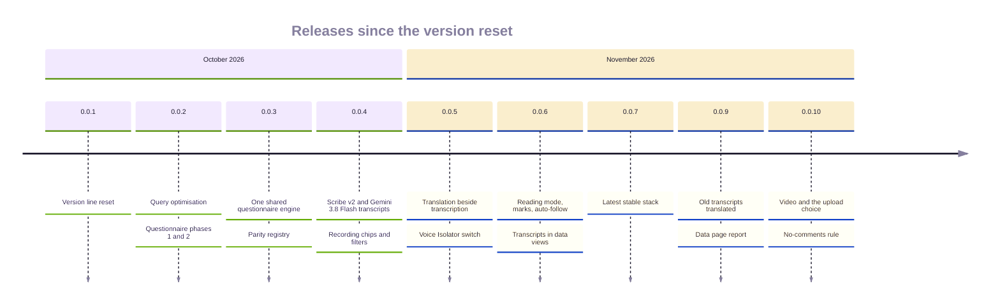

# Release runbook: data steps

The steps a release has to take on the production data, after the deploy has applied the migrations. The same page in both repositories. Each step names the release that introduced it.

## The releases

Both portals release together from a branch `release/<version>` of the same name, merged locally, with one deploy per platform. The Android version line was reset to 0.0.1 on 2026-10-21; the version code keeps rising and `publish-android.yml` refuses a code at or below the published one.

| Release | Date | DR code | FR code | What shipped |
|---|---|---:|---:|---|
| 0.0.1 | 2026-10-21 | 27 | 22 | The version line reset |
| 0.0.2 | 2026-10-22 | 28 | 23 | Query optimisation; questionnaire phases 1 and 2; a form's author may edit and delete it |
| 0.0.3 | 2026-10-22 | 29 | 24 | One shared questionnaire engine (`shared/questionnaire.sha256`), the parity registry `shared/questionnaire-features.json`, questionnaires v2 switched on |
| 0.0.4 | 2026-10-31 | 30 | 25 | The transcript pipeline: Scribe v2 turns, Gemini 3.8 Flash English, the viewer on web and Android, Ask, auto-draft, glossary, quote cards, the USD 100 monthly budget; recording chips and filters |
| 0.0.5 | 2026-11-01 | 31 | 26 | Translation beside transcription, the Gemini billing hold, admin-only cost and model names, speaker samples, copies without timestamps, the Voice Isolator switch (off) |
| 0.0.6 | 2026-11-01 | 32 | 27 | Transcript previews, reading mode, timeline marks and speaker colours, auto-follow, coverage dots, back navigation that restores the list, transcripts in View data and Download data, the sized transcription work directory (D37) |
| 0.0.7 | 2026-11-01 | 33 | 28 | The latest stable stack: Python 3.15.2, Node 26, Next.js 16.4, AGP 9.5, Gradle 9.8 |
| 0.0.8 | 2026-11-01 | · | · | `requires-python >=3.14` so Dependabot scans the backend; no app release |
| 0.0.9 | 2026-11-03 | 34 | 29 | Old transcripts queue their translation and a declined one takes a person's English (D38); the Data page report on a click (D39); the backup freshness check |
| 0.0.10 | 2026-11 | 35 | 30 | Video transcribed as its sound; the Transcribe and translate choice per file; admin auto switches; the backfill switch, off, with its cost estimate (D40); Gemini-first AI defaults with GPT-6 Luna and Claude Sonnet 5.5 only when selected; refine on every client; Android AI suggestions and summary edit; no comments in source, enforced in Checks; the README kit |

## Video, the upload choice and the backfill switch (DR 0.0.10, FR 0.0.10)

No data step runs on deploy. The migration adds the per-file choice columns and the three admin
switches, all off, and the release ships with them off.

1. Deploy.
2. When the owner asks (launch list D40), see what a backfill would cost first: on the server,
   through SSM, from the backend directory, `python scripts/backfill_transcripts.py`. It prints counts,
   hours and the estimated cost only.
3. Turn on "Transcribe and translate all previously uploaded media" in Settings. The clients show the
   same estimate and ask before they send `confirmBackfill: true`; the queue worker then queues at most
   25 at a time, oldest first, inside the month's budget.

Release note: researchers now tick **Transcribe and translate** per audio or video file at upload.
Videos are transcribed from their sound; nothing about the video changes.

## The craft master list (DR 0.0.24, FR 0.0.19, before the 21 Oct version reset)

The migration `20261104090000_craft_master_list` seeds the master list and marks every craft recorded before it LEGACY. The mapping is a separate, reviewed step ([CRAFTS.md](CRAFTS.md)):

1. Deploy. The migration runs.
2. On the server, through SSM, from the backend directory: `python -m app.scripts.map_crafts --dry-run`. Compare the output with the curated table in [CRAFTS.md](CRAFTS.md). Every row should be `inPlace`, `merge`, `adopt`, `link`, or a known `legacy` or `unmatched`.
3. `python -m app.scripts.map_crafts --apply`.
4. Run `--dry-run` again. It must report no `inPlace`, `merge`, `adopt` or `link` rows. What is left is the admin review queue on `/crafts`.

The script is idempotent: running it twice changes nothing the second time. It never deletes a craft.

Release note (Designer Repository): stage 1 now requires a craft from the list. A workshop with no linked craft, including the live "Test" and "Test Craft" workshops, shows stage 1 as incomplete until a craft is picked. Saving stage 1 with a craft that is not on the list is refused (`CRAFT_NOT_IN_LIST`).

## Old transcripts' translation (DR 0.0.9, FR 0.0.9)

1. Deploy.
2. On the server, through SSM, from the backend directory: `python -m app.scripts.queue_pending_translations`. It prints counts only.
3. `python -m app.scripts.queue_pending_translations --apply`. The queue translates them within the monthly budget.
4. Run the dry run again: `would-queue` reads 0. A `declined` count is recordings Gemini turned down; an editor adds their English on the transcript page.

## How this document is kept true

| Claim | Kept true by |
|---|---|
| The mapping's dry run, its curated table and its idempotence | `test_map_crafts.py` |
| The translation sweep's counts, dry run and idempotence | `test_transcript_db.py` |
| The migration name and what it seeds | `test_craft_master_migration.py` |
| The backfill's estimate, batch size and budget stop | `backend/scripts/backfill_transcripts.py` and its tests; the switch's 409 without `confirmBackfill` |
| The release table | the `Cut 0.0.x` commits, the `v0.0.x` tags and `appVersionCode` in each portal's `android/app/build.gradle.kts` |
