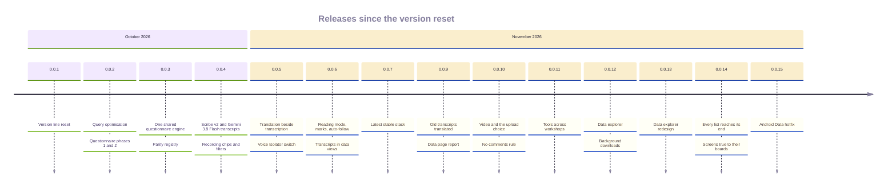

# Release runbook: data steps

The steps a release has to take on the production data, after the deploy has applied the migrations. The same page in both repositories. Each step names the release that introduced it.

## The releases

Both portals release together from a branch `release/<version>` of the same name, merged locally, with one deploy per platform. The Android version line was reset to 0.0.1 on 2026-10-21; the version code keeps rising and `publish-android.yml` refuses a code at or below the published one.

| Release | Date | DR code | FR code | What shipped |
|---|---|---:|---:|---|
| 0.0.1 | 2026-10-21 | 27 | 22 | The version line reset |
| 0.0.2 | 2026-10-22 | 28 | 23 | Query optimisation; questionnaire phases 1 and 2; a form's author may edit and delete it |
| 0.0.3 | 2026-10-22 | 29 | 24 | One shared questionnaire engine (`shared/questionnaire.sha256`), the parity registry `shared/questionnaire-features.json`, questionnaires v2 switched on |
| 0.0.4 | 2026-10-31 | 30 | 25 | The transcript pipeline: Scribe v2 turns, Gemini 3.8 Flash English, the viewer on web and Android, Ask, auto-draft, glossary, quote cards, the USD 100 monthly budget; recording chips and filters |
| 0.0.5 | 2026-11-01 | 31 | 26 | Translation beside transcription, the Gemini billing hold, admin-only cost and model names, speaker samples, copies without timestamps, the Voice Isolator switch (off) |
| 0.0.6 | 2026-11-01 | 32 | 27 | Transcript previews, reading mode, timeline marks and speaker colours, auto-follow, coverage dots, back navigation that restores the list, transcripts in View data and Download data, the sized transcription work directory (D37) |
| 0.0.7 | 2026-11-01 | 33 | 28 | The latest stable stack: Python 3.15.2, Node 26, Next.js 16.4, AGP 9.5, Gradle 9.8 |
| 0.0.8 | 2026-11-01 | · | · | `requires-python >=3.14` so Dependabot scans the backend; no app release |
| 0.0.9 | 2026-11-03 | 34 | 29 | Old transcripts queue their translation and a declined one takes a person's English (D38); the Data page report on a click (D39); the backup freshness check |
| 0.0.10 | 2026-11-04 | 35 | 30 | Video transcribed as its sound; the Transcribe and translate choice per file; admin auto switches; the backfill switch, off, with its cost estimate (D40); Gemini-first AI defaults with GPT-6 Luna and Claude Sonnet 5.5 only when selected; refine on every client; Android AI suggestions and summary edit; no comments in source, enforced in Checks; the README kit |
| 0.0.11 | 2026-11-04 | 36 | 31 | A tool linked to several artisans shows under every workshop those artisans belong to, in the data browser, reports and xlsx, folder zip, dataset bundle, tools filters, search and the datasets API; the tool sheet's Linked workshops column; web and Android tool rows name every linked artisan; no migration and no data step |
| 0.0.12 | 2026-11-05 | 37 | 32 | The data explorer in both portals and on every client: tree first with search as its toolbar and every download in one place; sizes before a download; multi-select; thumbnails and previews; table search over every row and a CSV per sheet; browse by type with pages; transcripts fetched on demand and all formats in one zip per transcript or folder; removed recordings never ship; audio streamed to `.mp4` with the original as fallback; web zips stream to disk in a worker and keep going in a hidden tab; Android zips run as a background data-sync job with a notification and Cancel; usage logging in FR; DR dictation allowance polled at most every 10 minutes; unified search finds a tool under every workshop its linked artisans belong to; migration `20261205090000_usage_event` in FR and `20261205090000_search_tool_workshops` (two search triggers) in DR; data step: `python -m scripts.search_reindex --type tools` once on each box |
| 0.0.13 | 2026-11-05 | 38 | 33 | The data explorer redesign in both portals and on every client: the report waits in a queue and is cached per folder, report options with remembered choices, saved views, new-since-you-looked counts, live report links, waveforms and clear voices, the workshop overview with section links, every transcript of a folder in one `.docx`, row numbers, captured dates, folder counts and sizes, resumable folders, scheduled report e-mails; Android background downloads; migrations `20261210090000_data_explorer_memory`, `20261211100000_data_bundles`, `20261211200000_data_report_share` and `20261211300000_data_report_schedules` in FR |
| 0.0.14 | 2026-11-06 | 39 | 34 | Every list reaches its last record on web and Android, with paging where the server stopped short; screens true to their approved design boards; the Data report's status filter shown in its options and FR Data defaulting to All statuses, with root questionnaires in the report; the Android publish waits for the backend deploy and its /health release fingerprint; Checks compares shared manifests with the peer's same-named branch, main or newest tag |
| 0.0.15 | 2026-11-07 | 40 | 35 | Android Data hotfix in both portals: explorer state no longer keyed on the Retrofit service (blank Data, request flood, FR out-of-memory), discarded loads cancelled, the saved place written only on a folder change; links consumed after they are handled, cancellation kept, the real media type from `/data/go/media` (now in its JSON), error-toned link messages; tablet content pane lists subfolders, grouping roots are the top, a skeleton until the first folder; a device test with a real Retrofit client against MockWebServer; the message banner shows on every screen including Data, Back returns to the folder viewed before and skips grouping folders never opened, cluster results open their design workshops, a link left behind when Data closes is cleared and a locate fallback finishes before the link is used up, a saved view that cannot be reached reads apart from a missing one, calls the app cancels are neither retried nor counted as lost connections; the backend reuses one S3 client built under a lock (FR 084cb799, cf6ecd21; DR the same lock and test); Search everything (button and keyboard key) clears the jump field and its filters and hides the keyboard before the full search opens; the explorer scrolls to the top when a record outside any folder or a new error notice appears, so tablets show it; `/questionnaire/completion` returns 404 only for an artisan that does not exist and an empty artisan list for one outside the selected workshops; no migration and no data step |

## Release push order

1. Merge both release branches locally, then push both `main` branches, either first, within about ten minutes of each other. Each repository's Checks compares its shared files with the other repository: it takes the other's branch of the same name, its `main` or its newest `v*` tag, whichever has the same shared files, and waits up to ten minutes for the other `main` to catch up. The step prints the peer ref and SHA it compared. A real mismatch still fails.
2. Each push to `main` starts `deploy-backend.yml`.
3. Push the `vX.Y.Z` tags straight away. `publish-android.yml` waits up to 90 minutes for `deploy-backend.yml` on the tagged commit to succeed. Then it waits for `/health` to report that commit's backend as `release`, the SHA-256 that `backend/app/release.py` takes over `backend/app/**/*.py`, `prisma/schema.prisma` and the migrations. If the deploy failed or never ran, or a different backend is live, the publish stops and says why. Fix the backend, then run the publish again. A manual run with `dry_run` off goes through the same gate. A dry run reports what the gate found and carries on.

## Release gate

`release-gate.yml` runs by hand, after the deploy, from the commit that went out. It checks that the backend for that commit is live, then runs every real-data check against production and fails if any check fails. Every request is read-only. The screenshots, counts and expected-versus-actual tables are kept as the artifact `release-gate-<portal>-<sha>` for 90 days. The input `checks` runs only the checks it names.

How to add a check, the same in both repositories:

- A Python check is `scripts/release_gate/checks/<name>.py` with `def run(gate)`. `gate` is `scripts/release_gate/gate.py`. Use `gate.sign_in()`, `gate.get(path)` and `gate.get_json(path)` to read, `gate.count(name=value)` for counts, `gate.expect(item, expected, actual)` for one table row (it passes when they are equal; pass `ok=` for any other rule), and `gate.save(file, bytes)` for a file such as a downloaded xlsx. An exception fails the check and its message is kept.
- A browser check is `frontend/release-gate/<name>.spec.ts`. It imports `{ test, expect }` from `./gate` and uses the `gate` fixture, which signs the page in. Use `gate.shot(name)` for a full-page screenshot, `gate.count({...})`, `gate.expectRow(item, expected, actual)` and `gate.get(path)` for an authorised API read. `baseURL` is the production web app.
- Each check writes `<GATE_OUT>/<check>/result.json` holding `{check, kind, ok, error, blocked, counts, rows}`, with its screenshots and files beside it. `summary.md` and `summary.json` collect them, and the summary also goes to the run page.
- Read-only is enforced, not trusted. A `PUT`, `PATCH` or `DELETE` is refused before it is sent, and so is any `POST` to the API or to a web `/api/` path that `scripts/release_gate/read_only_posts.txt` does not list. A refused request fails the check and names the call. List a `POST` there, with the reason on its line, only when it changes nothing users can see.
- Environment: `GATE_API`, `GATE_WEB`, `GATE_PORTAL`, `GATE_SHA`, `GATE_OUT`, `GATE_EMAIL` and `GATE_PASSWORD`. The account comes from `RELEASE_GATE_EMAIL` and `RELEASE_GATE_PASSWORD`, falling back to the publishing account.
- The harness files are byte-identical in both repositories, and Checks compares them. The checks under `checks/` and `release-gate/` may differ per portal.

## Video, the upload choice and the backfill switch (DR 0.0.10, FR 0.0.10)

No data step runs on deploy. The migration adds the per-file choice columns and the three admin
switches, all off, and the release ships with them off.

1. Deploy.
2. When the owner asks (launch list D40), see what a backfill would cost first: on the server,
   through SSM, from the backend directory, `python scripts/backfill_transcripts.py`. It prints counts,
   hours and the estimated cost only.
3. Turn on "Transcribe and translate all previously uploaded media" in Settings. The clients show the
   same estimate and ask before they send `confirmBackfill: true`; the queue worker then queues at most
   25 at a time, oldest first, inside the month's budget.

Release note: researchers now tick **Transcribe and translate** per audio or video file at upload.
Videos are transcribed from their sound; nothing about the video changes.

## The craft master list (DR 0.0.24, FR 0.0.19, before the 21 Oct version reset)

The migration `20261104090000_craft_master_list` seeds the master list and marks every craft recorded before it LEGACY. The mapping is a separate, reviewed step ([CRAFTS.md](CRAFTS.md)):

1. Deploy. The migration runs.
2. On the server, through SSM, from the backend directory: `python -m app.scripts.map_crafts --dry-run`. Compare the output with the curated table in [CRAFTS.md](CRAFTS.md). Every row should be `inPlace`, `merge`, `adopt`, `link`, or a known `legacy` or `unmatched`.
3. `python -m app.scripts.map_crafts --apply`.
4. Run `--dry-run` again. It must report no `inPlace`, `merge`, `adopt` or `link` rows. What is left is the admin review queue on `/crafts`.

The script is idempotent: running it twice changes nothing the second time. It never deletes a craft.

Release note (Designer Repository): stage 1 now requires a craft from the list. A workshop with no linked craft, including the live "Test" and "Test Craft" workshops, shows stage 1 as incomplete until a craft is picked. Saving stage 1 with a craft that is not on the list is refused (`CRAFT_NOT_IN_LIST`).

## Old transcripts' translation (DR 0.0.9, FR 0.0.9)

1. Deploy.
2. On the server, through SSM, from the backend directory: `python -m app.scripts.queue_pending_translations`. It prints counts only.
3. `python -m app.scripts.queue_pending_translations --apply`. The queue translates them within the monthly budget.
4. Run the dry run again: `would-queue` reads 0. A `declined` count is recordings Gemini turned down; an editor adds their English on the transcript page.

## How this document is kept true

| Claim | Kept true by |
|---|---|
| The mapping's dry run, its curated table and its idempotence | `test_map_crafts.py` |
| The translation sweep's counts, dry run and idempotence | `test_transcript_db.py` |
| The migration name and what it seeds | `test_craft_master_migration.py` |
| The backfill's estimate, batch size and budget stop | `backend/scripts/backfill_transcripts.py` and its tests; the switch's 409 without `confirmBackfill` |
| The release table | the `Cut 0.0.x` commits, the `v0.0.x` tags and `appVersionCode` in each portal's `android/app/build.gradle.kts` |
