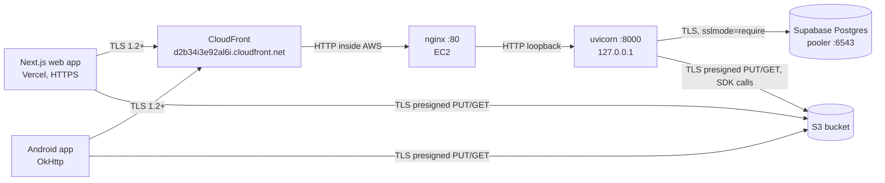

# Security: data in transit and at rest

How field data — artisan PII, GPS points, photographs, interview recordings and their transcripts —
is protected between the capture device and storage, what protects it once stored, and the risks
that are still open. Everything marked **ACTION** needs a human in a console; the code side is
already in the repository.

Audience: whoever operates the deployment (AWS + Supabase + Vercel consoles) and whoever reviews
changes to `backend/app/core/*` and the Android network configuration.

---

## 1. Transport



| Hop | Protection | Where it is enforced |
|---|---|---|
| Browser / phone → API | TLS 1.2+ terminated at CloudFront | `android/app/build.gradle.kts` default `apiBaseUrl`, Vercel `NEXT_PUBLIC_API_URL` |
| CloudFront → nginx (EC2 origin) | **Plaintext HTTP inside AWS** — see risk P1 | CloudFront origin protocol policy |
| nginx → uvicorn | Plaintext on loopback (never leaves the box) | `ExecStart … --host 127.0.0.1` |
| Client → S3 (media bytes) | TLS; presigned URLs are always `https://` | `backend/app/services/s3.py` builds `https://s3.dualstack.<region>.amazonaws.com` |
| API → Postgres | TLS, **no plaintext fallback** | `sslmode=require` injected in `backend/app/core/config.py` |
| API → AI providers | TLS (vendor SDKs/HTTP clients) | `backend/app/services/ai.py` |

### 1.1 Database TLS

Supabase's pooler speaks TLS, but libpq and Prisma's Postgres connector default to
`sslmode=prefer`, which attempts TLS and then **silently falls back to plaintext** if the handshake
fails. A downgrade — a broken proxy, a hostile network — would then ship the database password and
every row in the clear, with nothing in the logs to show for it.

`Settings._harden_database_url` therefore appends `sslmode=require` to `DATABASE_URL` as soon as
settings load, so both the pooler rewrite in `core/db.py` and any script inherit it. The rule:

- **Remote host** (Supabase pooler, RDS, anything not loopback/private) → `sslmode=require`.
- **Local host** (`localhost`, `127.0.0.1`, a private/RFC1918 address, a docker-compose service
  name) → left alone, because the docker-compose Postgres ships no certificate and `require` would
  break local development and the test suite.
- **Already configured** (`sslmode`/`sslaccept`/`sslcert`… already in the URL) → left alone; an
  explicit operator choice always wins.
- `DATABASE_REQUIRE_SSL=true|false` forces either answer.

`prisma migrate deploy` is unaffected: it reads `DATABASE_URL` straight from the environment, not
from this Settings object. Add `?sslmode=require` to the deployed `.env` value if you want
migrations covered too (harmless — Supabase supports it on both pooler ports).

### 1.2 Security response headers

`SecurityHeadersMiddleware` in `backend/app/main.py` is registered last, which makes it the
**outermost user middleware**, so it stamps route responses, CORS preflights and the responses
produced by exception handlers (including the JSON 4xx/5xx bodies FastAPI raises). It is pure ASGI
(no `BaseHTTPMiddleware`), so it adds nothing to streaming responses or request cancellation, and it
never overwrites a header a route already set.

**One response is not covered.** Starlette's `ServerErrorMiddleware` — the last-resort handler for an
exception that escapes every user middleware — sits *outside* the whole user middleware stack, so its
bare `Internal Server Error` 500 goes out unstamped. That response carries no data and no
`Access-Control-Allow-Origin` either, so it is not a disclosure path; it is simply the one gap in
"every response". Do not read the table below as covering it.

| Header | Value | Why |
|---|---|---|
| `Strict-Transport-Security` | `max-age=63072000; includeSubDomains` | Browser refuses plaintext to this host for 2 years. **Only sent when the request arrived over TLS** (`scheme == https`, `X-Forwarded-Proto`, `CloudFront-Forwarded-Proto`, `X-Forwarded-Ssl`), so a local `http://` dev server never poisons a developer's browser. |
| `X-Content-Type-Options` | `nosniff` | Stops a JSON error body being sniffed into HTML/JS and executed. |
| `X-Frame-Options` | `DENY` | Clickjacking defence for browsers predating CSP `frame-ancestors`. |
| `Content-Security-Policy` | `default-src 'none'; frame-ancestors 'none'; base-uri 'none'; form-action 'none'` | A JSON API loads nothing and may not be framed. |
| `Referrer-Policy` | `strict-origin-when-cross-origin` | Keeps record ids and query strings out of the `Referer` sent to S3/MapTiler/Google. |
| `Permissions-Policy` | camera/mic/geolocation/… all `()` | Denies every powerful browser feature on this origin. |
| `X-Permitted-Cross-Domain-Policies` | `none` | No Flash-era cross-domain policy file is honoured. |

`/docs`, `/docs/oauth2-redirect` and `/redoc` are real HTML pages that load Swagger-UI / ReDoc from
jsdelivr, so they receive a narrower-but-workable CSP instead of the API one. Everything else gets
the strict policy. Whether those pages are served *at all* is now a setting — see §1.4.

### 1.4 The interactive docs and the OpenAPI schema

FastAPI serves `/docs`, `/redoc` and `/openapi.json` to anyone by default, and **on this deployment
they are currently reachable unauthenticated.** Verified 2026-07-27:

```
/docs          200
/redoc         200
/openapi.json  200   ~190 KB
```

The schema names every route, every query parameter and every field of every model, including the
ones behind admin-only roles. That is a map of the API handed to whoever asks, and it is worth
nothing to the researchers this app is for, none of whom read an OpenAPI schema.

`BACKEND_EXPOSE_DOCS` now controls all three, and it defaults to **`False`**. The default is closed
rather than open because the production `.env` lives in a GitHub secret this repository cannot read,
so a default-on flag would leave the docs exposed exactly where it matters. **The fix is in the tree
and not yet deployed**; the next backend deploy closes them. Local development opts back in with
`BACKEND_EXPOSE_DOCS=true`, which `.env.example` ships commented in.

**HSTS in production.** The viewer's TLS terminates at CloudFront, and nginx overwrites
`X-Forwarded-Proto` with its own (plaintext) scheme, so the app usually cannot tell that the viewer
used HTTPS. Set `SECURITY_FORCE_HSTS=true` in the EC2 `.env` to emit HSTS unconditionally.
`SECURITY_HSTS_ENABLED=false` disables the header entirely; `SECURITY_HSTS_MAX_AGE` tunes the age.

`preload` is deliberately **not** in the header. The API is served from a shared
`*.cloudfront.net` domain; submitting a shared domain to the HSTS preload list is not ours to do.
Once the API moves to a dedicated domain, adding `preload` becomes reasonable.

### 1.3 CORS

`BACKEND_CORS_ORIGINS` is an explicit allow-list, parsed defensively (comma **or** newline
separated, tolerant of pasted quotes/brackets, trailing slashes stripped because an `Origin` is only
ever `scheme://host[:port]`, duplicates dropped).

If the list contains `*`, `Settings.cors_allow_credentials` turns **false** and `create_app()` logs
an error. Reason: browsers reject a literal `Access-Control-Allow-Origin: *` alongside
`Allow-Credentials: true`, and Starlette works around that rejection by echoing the *caller's*
origin when the request carries cookies — turning a lazily-configured `*` into "any website may
call this API as the signed-in user". Keep `BACKEND_CORS_ORIGINS` set to the exact Vercel origin.

### 1.4 Android

`android/app/src/main/res/xml/network_security_config.xml`:

- `base-config cleartextTrafficPermitted="false"` — TLS required for every host not named below.
- Cleartext is permitted **only** for `10.0.2.2` (emulator → host machine), `127.0.0.1` and
  `localhost`. The production EC2 origin (`ec2-15-207-145-174….compute.amazonaws.com`,
  `15.207.145.174`) was **removed**: it is a production host reachable only over plaintext HTTP, and
  keeping it listed meant one line in `local.properties` could ship bearer tokens and field data in
  the clear.
- Trust anchors are `system` only, so a user-installed CA (corporate MITM root, mitmproxy) cannot
  silently decrypt app traffic. `debug-overrides` re-adds `user` for debuggable builds only, so
  proxy debugging still works during development.
- `AndroidManifest.xml` sets `android:usesCleartextTraffic="false"`. The XML config takes precedence
  on every supported API level (minSdk 26); the manifest flag states the same intent for platform
  APIs that read it directly.

Developing against a LAN backend from a real phone: add your machine's private IP as an extra
`<domain>` **temporarily** and do not commit it. On Android 17 (the app targets 37 since 2026-10-09)
a LAN address — and the emulator's `10.0.2.2` — also needs the runtime `ACCESS_LOCAL_NETWORK`
permission, which only debug builds declare (`android/app/src/debug/AndroidManifest.xml`); the
release APK never asks for it, because production is public HTTPS.

Two Android 17 defaults apply to this file without it changing, and both are left on deliberately:
**Certificate Transparency** is enforced for every connection that trusts the system store (every
host the app reaches presents CT-logged certificates, checked 2026-10-09), and **Encrypted Client
Hello** is attempted where the networking library supports it. The comment at the top of
`network_security_config.xml` says what each means for this app.

---

## 2. At rest

### 2.1 S3 (media: photos, video, audio, documents, transcodes, APK releases)

| Path | Encryption | Mechanism |
|---|---|---|
| Multipart upload (large files) | Explicit SSE-S3 (AES-256) | `create_multipart_upload(..., ServerSideEncryption=…)` — `AWS_S3_SSE_ALGORITHM`, default `AES256` |
| Single presigned PUT (most web uploads) | **Bucket default encryption** | Applied server-side by S3 regardless of what the client sends |

**Why the single-PUT path cannot set the header in code.** Adding `ServerSideEncryption` to the
presign parameters puts `x-amz-server-side-encryption` into the SigV4 *signed headers*, which makes
it mandatory for the client: any PUT without that exact header fails with `SignatureDoesNotMatch`.
Both clients send only the headers `/media/presign` returns (`Content-Type`), and Android builds
already installed in the field can never be retrofitted — so signing it would break every upload,
including from phones that will never be updated. Bucket default encryption achieves the same
result with no client cooperation, which is why it is the load-bearing control here.

**ACTION — enable bucket default encryption** (S3 console → your bucket → Properties → Default
encryption → Edit): *Server-side encryption with Amazon S3 managed keys (SSE-S3)*, Bucket Key
enabled. Buckets created after January 2023 have this on by default — **verify** rather than assume,
and note it only applies to objects written *after* it is switched on. Re-encrypt anything older
with an in-place copy:

```bash
aws s3 cp s3://YOUR_BUCKET/media/ s3://YOUR_BUCKET/media/ \
  --recursive --sse AES256 --metadata-directive REPLACE
```

**ACTION — deny plaintext access to the bucket.** Add this statement to the bucket policy (S3
console → Permissions → Bucket policy). It rejects any request that did not arrive over TLS, which
covers the public media reads as well as the presigned PUTs:

```json
{
  "Sid": "DenyInsecureTransport",
  "Effect": "Deny",
  "Principal": "*",
  "Action": "s3:*",
  "Resource": [
    "arn:aws:s3:::YOUR_BUCKET",
    "arn:aws:s3:::YOUR_BUCKET/*"
  ],
  "Condition": { "Bool": { "aws:SecureTransport": "false" } }
}
```

Keep the existing `PublicReadMedia` allow statement (see `backend/DEPLOY_AWS.md` §4) — an explicit
`Deny` always wins over an `Allow`, so ordering does not matter.

**Do NOT add** the "deny unencrypted object uploads" statement
(`s3:x-amz-server-side-encryption` `Null: true`) that hardening guides usually pair with this. It
would reject exactly the presigned single PUTs described above and break all small-file uploads.
Default encryption already covers them.

**Media objects under `media/*` are world-readable.** The bucket policy grants `s3:GetObject` to
`Principal: "*"`, so anyone who learns an object URL can fetch the file without any token — the
object key (`media/<user-id>/<uuid>/<filename>`) is the only secret. Encryption at rest does not
change this; SSE-S3 protects the physical disks, not URL holders. See risk P0.

### 2.2 Supabase Postgres

- Supabase encrypts the underlying storage volumes and automated backups at the platform level
  (AES-256); no application configuration is required or possible.
- Passwords are stored as bcrypt hashes, cost 12 (`bcrypt` 5 called directly since 2026-10-09; it
  was passlib's `CryptContext(schemes=["bcrypt"])` before, which wrote the same `$2b$12$` format, so
  no stored hash changed and none needs re-hashing). Google sign-in accounts have no password hash
  at all.
- **bcrypt reads at most 72 bytes of a password.** passlib on bcrypt 4 cut longer input to 72 bytes
  without a word; bcrypt 5 refuses it. So a password being SET must fit in 72 bytes of UTF-8 — the
  user schemas answer 422 with that sentence, and it is bytes, not characters: a Devanagari letter
  is three — while a password being CHECKED is cut to 72 bytes exactly as passlib cut it when the
  stored hash was written, so an account whose password was set longer before 2026-10-09 still
  signs in. `backend/tests/test_auth_library_swap.py` holds hashes written by the old passlib/bcrypt
  pair and proves both halves.
- **Nothing is encrypted at the column level.** Artisan names, phone numbers, addresses, GPS
  coordinates, interview transcripts and researcher notes are plaintext columns. Anyone with the
  database URL, a Supabase dashboard login, or a `DATABASE_URL` leak reads all of it. Treat the
  Supabase credentials as the crown jewels.
- Row Level Security is **not** in use: the API connects as the owning role and enforces every
  access rule in application code (`backend/app/core/deps.py`). A SQL-injection bug or a leaked
  connection string bypasses the entire RBAC ladder in one step. Prisma's parameterised queries are
  what stand between the two; keep raw SQL (`db.query_raw`) free of string interpolation.

### 2.3 What is *not* encrypted, anywhere

| Data | Where it sits | State |
|---|---|---|
| Media object keys / public URLs | `MediaFile.url` in Postgres, and in every client | Plaintext, and the URL alone grants read access |
| Auth token (web) | `__Host-session` cookie on the web app's own domain, since the cookie-session release (§3.4); `localStorage["field_repo_token"]` before it | `HttpOnly`: no script can read it. Plaintext inside the browser's cookie store, like every cookie |
| Auth token (Android) | `SharedPreferences("field_repository_auth")`, `MODE_PRIVATE`, key `jwt_sealed` | AES-256-GCM under a non-exportable Android Keystore key since 2026-10-17 (`TokenStore`); the file is excluded from backup and device transfer. A phone whose Keystore does not work keeps the old plain `jwt` value rather than signing the person out |
| `.env` on EC2 | `/home/ubuntu/app/backend/.env`, `EnvironmentFile=` | Plaintext, on a root volume that is **not** encrypted on the box running on 2026-10-09 (read from AWS that day; §5 P3); holds `DATABASE_URL`, `JWT_SECRET`, AWS keys, every AI provider key |
| Temporary media during processing | `tempfile` on the EC2 disk (ffmpeg/transcription) | Plaintext; removed after the job |
| CSV / dataset exports | Streamed to the downloader | Plaintext; once downloaded the data is outside every control in this document |

---

## 3. Authentication and sessions

### 3.1 Tokens

| Property | Value | Enforced in |
|---|---|---|
| Algorithm | HS256 (HMAC), **pinned on decode** | `decode_access_token(..., algorithms=[settings.jwt_algorithm])` |
| Allowed algorithms | HS256 / HS384 / HS512 only | `Settings._normalise_jwt_algorithm` — `JWT_ALGORITHM=none` refuses to start |
| Expiry | `JWT_EXPIRES_MINUTES`, default 10080 (7 days) | `create_access_token`; `verify_exp` and `exp` in PyJWT's `require` list on decode |
| Subject | `sub` = user id, required | `sub` in the same `require` list, re-checked in `deps.get_current_user` |
| Library | PyJWT (since 2026-10-09; python-jose until then) | python-jose's latest release is still affected by GHSA-3qf3-8w2g-rqmx with no fix, and it pulled in `ecdsa` (CVE-2024-23342, unfixed). An HS256 token is one wire format, so every token issued before the swap still verifies; `backend/tests/test_auth_library_swap.py` decodes tokens python-jose minted. |
| Secret | ≥ 32 characters, never the example placeholder | `verify_jwt_configuration()` at `create_app()`. 32 is right for the default HS256; for HS384 or HS512, PyJWT raises an `InsecureKeyLengthWarning` (a Python warning, not an error) whenever it signs or verifies with a secret shorter than the hash size (48 or 64 bytes, RFC 7518 §3.2) — use one that long before switching algorithm. |

Pinning the algorithm closes **algorithm confusion**: without it, a token whose header says
`alg: none` is unsigned-but-accepted, and one that says `alg: RS256` is verified with our shared
secret treated as a public key. Requiring `exp` closes the "token with no expiry claim lives
forever" variant.

**The API refuses to start** if `JWT_SECRET` is the `.env.example` placeholder, is empty, or is
shorter than 32 characters — a guessable HMAC secret lets anyone mint a master-admin token, so it
must fail visibly on deploy rather than silently in production. `ALLOW_WEAK_JWT_SECRET=true`
downgrades the refusal to a `CRITICAL` log line for local development only.

Generate a real one with:

```bash
python -c "import secrets; print(secrets.token_urlsafe(48))"
```

### 3.2 Known weaknesses (accepted, with mitigations listed in §5)

- **Token storage was `localStorage` on the web until the cookie-session release (§3.4).** Any
  successful XSS on the frontend origin could read the token and use it anywhere for up to 7 days.
  Since §3.4 the token is in an `HttpOnly` cookie: a script running on the page can still act as the
  user while the page is open (it can call `/api/*`, and the browser adds the cookie), but it can no
  longer carry the token off.
- **No refresh tokens and no revocation.** A token is valid until `exp`. Deleting or demoting a
  user does not invalidate their existing token for role checks embedded in the token; note that
  `get_current_user` re-loads the user row on every request, so a *deleted* user is rejected
  immediately and a *demoted* user loses privileges immediately — the role in the token is not
  trusted for authorisation. Rotating `JWT_SECRET` invalidates every token at once and is the
  break-glass response to a suspected theft.
- **7-day lifetime** is long for a token that cannot be revoked. It is a deliberate trade for field
  work with intermittent connectivity.
- **Android backup.** `android:allowBackup="true"` lets the auth token and preferences travel
  through Google's backup. Excluding them needs a `dataExtractionRules` / `fullBackupContent`
  resource, or moving the token to `EncryptedSharedPreferences`.

### 3.3 Google sign-in

Google ID tokens are verified server-side against Google's keys with the audience restricted to
the configured client ids (`GOOGLE_CLIENT_ID`, `GOOGLE_ANDROID_CLIENT_ID`). Brand-new self-registered
accounts land on `DEFAULT_SIGNUP_ROLE`, which defaults to the **lowest** tier
(`CROWDSOURCE_VOLUNTEER`) so an unknown Google account cannot read or write as a researcher until an
admin elevates it.

### 3.3A Microsoft and Yahoo sign-in (2026-10-10)

Both are OpenID Connect, driven as an **authorization code with PKCE (S256) and a nonce** and
**redeemed by the backend** with the client secret (`backend/app/services/oidc_sign_in.py`). Yahoo's
token endpoint accepts only a client secret and answers no cross-origin request, so no phone and no
browser could redeem a Yahoo code without holding a secret it must not hold; Microsoft is driven the
same way so there is one path. Each provider is live only when its client ID and secret are both set
(`MICROSOFT_CLIENT_ID`/`_SECRET`, `YAHOO_CLIENT_ID`/`_SECRET`); a client draws a button only when its
own build carries the client ID — never a disabled one or a "coming soon" badge.

- **One redirect URI**, the web app's `/login/callback` (a route handler). A web `state` goes back to
  `/login` with the answer in the URL **fragment** — no server log, no `Referer` — and the page takes
  it off the address bar before using it. A `state` starting `app.` is handed to the Android app on
  `com.fieldrepository.app.signin://oidc/callback`, where AppAuth refuses any `state` it did not send.
  A code intercepted on that hop is useless without the PKCE verifier, which never leaves the app or
  browser tab that started the flow.
- **The ID token is verified even though it came over the TLS back channel**: signature against the
  provider's JWKS (RS256 or ES256 only), issuer (Yahoo's fixed one; Microsoft's per-tenant one bound to
  the token's `tid` and to `MICROSOFT_TENANT`), audience (`azp` when there are several), `exp`/`nbf`/
  `iat` with a minute of leeway, and the **nonce** — the provider is sent `base64url(sha256(raw))`, the
  backend the raw value, so a token is accepted only from whoever started the flow that minted it.
- **The address must be verified by the provider**: Yahoo's `email_verified`; for Microsoft, a
  personal account (tenant `9188040d-…`), or a work or school account whose token carries the optional
  claim `xms_edov` true (the owner adds `email` and `xms_edov` to the registration's ID token). This
  closes the "nOAuth" takeover. An unverified address is a 401 before the roster is consulted, so
  nothing is written.
- **The roster gate and the account rules are Google's** (`auth._sign_in_verified_address`, the one
  function both paths end in): the gate decides before any write, the same three refusals, the same
  `grantedRole` floor, the same master-admin exemption; the account is found at the normalised address
  and nowhere else (no spelling is ever folded). A new account is recorded as `MICROSOFT` or `YAHOO`;
  Microsoft and Yahoo never overwrite an avatar, and record their provider only on an account that had
  none (`LOCAL`).
- **Logged**: the provider and a reason tag only — never a code, verifier, nonce, token, secret or
  response body.

### 3.3B Two-step verification (TOTP, 2026-10-16)

Opt-in for **every** account, from Settings on the web and Settings → Two-step verification on
Android. RFC 6238: SHA-1, 6 digits, 30-second steps, ±1 step accepted. Implemented in
`backend/app/services/two_factor.py` with the standard library; the routes are
`backend/app/api/routes/two_factor.py` and `DELETE /api/users/{id}/two-factor`.

- **Every sign-in method is challenged.** `POST /api/auth/login` (password, Google, Microsoft, Yahoo —
  and `/api/auth/google`, which wraps it) runs the roster gate, then, for an account with two-step
  verification on, answers `{"two_factor_required": true, "challenge_token": …}` and **no session**.
  `POST /api/auth/two-factor/verify {challenge_token, code}` returns the ordinary sign-in body. The
  challenge token is a JWT with `purpose: "2fa"`, a `scope` no route admits (so
  `deps._user_from_bearer` refuses it as a session with 403), a `jti`, and a 5-minute life. Its
  `TwoFactorChallenge` row counts attempts with a conditional increment: the fifth code spends the
  challenge, a correct code deletes it, and the roster gate runs again before the session is minted.
- **The secret is encrypted at rest** — AES-256-GCM with `TWO_FACTOR_ENCRYPTION_KEY` (2026-10-17), a
  key of its own, stored as `v2.<key id>.<iv>.<tag>.<ciphertext>` with the key id authenticated
  alongside (`app/core/two_factor_keys.py`). `TWO_FACTOR_ENCRYPTION_PREVIOUS_KEYS` still open secrets
  sealed with older keys; a secret on any key but the current one is re-encrypted the first time its
  code is accepted, or all at once by `scripts/reencrypt_two_factor_secrets.py` (dry run unless
  `--apply`, idempotent, conditional on the ciphertext it read). Unset, the legacy key
  `scrypt(JWT_SECRET, "field-repository-totp-v1")` and its `v1.<iv>.<tag>.<ciphertext>` format are used
  and a WARNING is logged at start-up; `v1` secrets are always still read. The secret is returned
  once, by `/setup`, while still *pending* (`User.twoFactorPendingSecret`), and never again. **Until
  the key is set, rotating `JWT_SECRET` makes every enrolled secret unreadable**: those people sign in
  with a recovery code or an administrator turns it off for them.
- **A code works once.** The accepted time step is written to `User.twoFactorLastStep` with a
  conditional update (`last step < this step`), so a code replayed inside its 90-second window, or two
  submissions racing, are refused. The enrolment code is recorded the same way.
- **A per-account failure budget**, because the five-code cap is per challenge and signing in again
  mints a fresh one. Every second-factor code — at `verify`, `disable`, `recovery-codes` and
  `POST /api/datasets/token` — first CLAIMS a slot with one conditional, atomic update
  (`twoFactorFailedAttempts < 10`, not locked, increment); no slot means `429 "Too many attempts. Try
  again later."` and the code is not checked, so a burst of concurrent guesses gets ten checks, not N.
  The window is a rolling 15 minutes (`twoFactorFailureWindowStartedAt`). When the tenth slot is spent
  on a wrong code, exactly one request writes the lock (a compare-and-swap on the window it closes) and
  increments `twoFactorLockouts`: 15 minutes, then 30, capped at **one hour**
  (`twoFactorLockedUntil`), so somebody holding only the password cannot keep the owner out for long;
  the lockout count decays to zero when a new window starts more than 24 hours after the last lock
  ended. Each lock is an `AUDIT two-factor locked …` line, beside enable/disable/reset, and the owner
  is e-mailed (`SECOND_FACTOR_LOCKED`, through the outbox; nothing is sent when mail is off): somebody
  entered the password and then wrong codes, two-step sign-in is paused until a stated time, change
  the password now. No code and no address is in it. **Recovery codes have their own budget** —
  five per window, the `twoFactorRecovery*` columns, the same atomic claim, lock, backoff and decay —
  independent of the six-digit one, so a six-digit lock never shuts the owner out: their recovery
  codes still work. `/auth/login` refuses to mint a challenge only when **both** are locked, and then
  says so with `/verify`'s own `429 "Too many attempts. Try again later."` — only a password holder
  can reach that answer, and hiding it would hide from the owner that the password is known. A
  correct code clears its own budget only if nobody claimed a slot after it (otherwise it hands back
  its own slot, so racing failures stay counted); turning it off or an administrator's reset clears
  both.
- **A first password needs the provider again (2026-10-17).** An account with no password (Google,
  Microsoft or Yahoo only) sets one with `POST /api/auth/change-password` only when the request carries
  that provider's sign-in RUN AGAIN — a Google ID token, or a Microsoft/Yahoo code with its PKCE
  verifier and nonce — whose `iat` is under five minutes old, whose verified address is the account's
  and which names a subject; otherwise `400` with `X-Confirm-Sign-In: <provider>` (never `401`, which
  the clients read as a dead session). The session's age is no longer the proof: a stolen session must
  not be able to add a permanent way in. With two-step on, a code is asked for too, on **its own
  budget** — five checks per account per 15 minutes, kept on the account row so a restart hands out
  none (`two_factor.claim_first_password_check`, given back when right), not the sign-in's — so
  guessing there can neither lock the owner out of signing in nor buy more than five tries; a second
  factor the sign-in has locked stays locked there. Everything that check can refuse without reading
  the code (no code, locked, budget spent) is refused BEFORE a Microsoft/Yahoo code is redeemed, and a
  wrong code after an accepted sign-in answers `X-Sign-In-Proof`: a token signed with its own key
  (never a session), bound to the account, single use, and dead when the sign-in it stands for turns
  five minutes old. The clients send it back as `providerProof`, so a typo costs no trip to the
  provider. Known limit: the Google ID token carries no nonce, so any token for our audience issued in
  the last five minutes is accepted, and the provider may finish a "sign in again" from its own
  session without asking for anything.
- **The dataset token is a sign-in too.** `POST /api/datasets/token` for an account with two-step
  verification on requires `code`, checked by the same path (spent once, recovery codes allowed,
  counted against the budget); missing or wrong is one generic `401`.
- **No secret column leaves the API.** `app/core/user_fields.py::SECRET_USER_FIELDS` — the password
  hash, both secrets, the recovery-code hashes, the last step and the four budget columns — is the one
  list `routes/auth.py`, `routes/users.py` and `services/records.public_encode` strip, the last at any
  depth of an embedded User (media `uploadedBy`, workshops, tasks, the data browser, the export).
- **Recovery codes**: ten `xxxx-xxxx` codes from an alphabet without look-alikes, stored as bcrypt
  hashes at the password cost, shown once at enable time and on "Make new recovery codes" (which needs
  a 6-digit code). Each is consumed by a compare-and-swap on the whole list. Turning it off accepts a
  6-digit or a recovery code; the codes go with the secret.
- **Administrator reset**: `DELETE /api/users/{id}/two-factor` — an admin over somebody ranked below
  them (the master admin over anyone), never their own account; the same rule as deleting the account.
  It removes the secret and the recovery codes and never reads either. Sessions already issued are not
  revoked (there is no revoke-all; see §3.2).
- **Audited** as `AUDIT two-factor …` lines at WARNING (journald on the box): enabled, disabled by its
  owner, reset by an administrator (with who), recovery code used, recovery codes replaced.
- **Offline (Android)**: the second step is asked only at an online sign-in; a session already on the
  phone keeps working offline.

---

### 3.4 The web sign-in session is an HttpOnly cookie (2026-10-17)

**State: built on `feature/cookie-session`, ships with the next release.** Until then the web token
is in `localStorage` (§5 P4).

The web app no longer holds the session token. The browser calls the API **same-origin**, through
the web app's own server, and the token lives in a cookie no script can read.

```
browser ──/api/* (same origin, cookie)──> Vercel: proxy.ts / app/api/* route handlers
        ──https, Authorization: Bearer <token from the cookie>──> CloudFront ──> nginx ──> API
```

The web app (`*.vercel.app`) and the API (`*.cloudfront.net`) are different sites, so a cookie set
by the API would be a third-party cookie, which browsers block. The cookie is therefore the web
app's own, and only the web app's server turns it into a bearer token.

| Piece | Where | What it does |
|---|---|---|
| Session cookie | `__Host-session` | The token. `HttpOnly; Secure; SameSite=Lax; Path=/`, no `Domain`, `Max-Age` = what is left of the token's `exp`. The `__Host-` prefix makes the browser refuse it unless it is Secure, host-only and `Path=/`. |
| Marker cookie | `__Host-session-marker` | A random id, readable by scripts, that changes whenever the session does. The page uses it for "is anybody signed in" and "did the session change while this request was out" (`lib/session.ts`). It is never sent to the API and grants nothing. |
| Sign-in | `app/api/auth/login`, `app/api/auth/two-factor/verify`, `app/api/auth/google` | Forward to the API, take `accessToken` out of the JSON answer, set both cookies. The page gets the account and nothing else. A two-step challenge passes through untouched (it opens nothing). |
| Password change | `app/api/auth/change-password` | Sent with the cookie's token. The API's fresh token (`X-Session-Token`, §3.6) goes into the cookie; the header is removed and the page sees `X-Session-Rotated: 1`. |
| Sign-out | `app/api/auth/logout` | Tell the API, then clear both cookies whatever it answered. |
| A refused session | `app/api/session/end` | When the API refuses the token (401), the page asks for the cookie to be cleared, naming the marker it saw, so a session that replaced it meanwhile is left alone. |
| Everything else | `proxy.ts` | Cross-site check, cookie → `Authorization: Bearer`, then a **rewrite** to the API. |

**Uploads and downloads stream.** `proxy.ts` rewrites; it does not fetch. Vercel forwards a rewrite
itself, so no Vercel Function sits in the path, the 4.5 MB function payload limit does not apply,
and nothing is held in memory. `vercel.json` sets `skipMiddlewareRequestBody`, so the request body
never even reaches the Proxy code, and `x-vercel-enable-rewrite-caching: 0`, so Vercel's CDN never
stores an answer. Photos, video and audio still go straight from the browser to S3 on presigned URLs.
The public Android download link still points at the API directly.

**What the API is sent: an allowlist (2026-10-18).** `upstreamHeaders` copies only the browser
headers it names (`FORWARDED_REQUEST_HEADERS`): `content-type`, `accept*`, `range` and `if-*`,
`user-agent`, `origin`, `x-forwarded-for`, `idempotency-key`, `x-client-app` and the sign-in
confirmation headers. It then sets `Authorization` from the cookie and adds the two proxy headers.
The `Cookie` header is never sent on, and neither is anything Vercel or Next.js added on the way in.
A new request header from a client must be added to that list, with its reason, or the API never
sees it.

Checked on a preview on 2026-10-18, with the proxy pointed at a temporary header echo. Before the
change the API also got `x-vercel-proxy-signature` (a bearer value), `x-vercel-proxy-signature-ts`,
`x-vercel-ja4-digest` and `x-vercel-proxied-for`. After it, none of them arrived. Vercel's edge still
adds a few headers on the way out that no project code can remove: `x-vercel-id` (a request id), the
visitor's address in `x-vercel-forwarded-for`, `x-real-ip`, `x-forwarded-for` and `forwarded` (the
API already gets it in `X-Viewer-Address`), plus `x-forwarded-host` and `x-forwarded-proto`. No
`x-vercel-oidc-token` reached the API on either build, though the project has OIDC federation
turned on. The same run showed that no `Cookie` arrived and `Authorization: Bearer` did, and that
`X-Web-Proxy-Secret` matched the SSM copy. `X-Viewer-Address` carried the visitor's real address,
not a forged one sent by the caller. A 5,000,000-byte upload and a 20 MiB download went through
whole, and a cross-site POST got 403. The check ran on a `designer-repository` preview; `lib/server/apiProxy.ts` is the same file in both portals.

**Cross-site request forgery.** Two locks. `SameSite=Lax` keeps the cookie off cross-site POSTs.
And every state-changing request (anything but GET/HEAD/OPTIONS) must carry
`Sec-Fetch-Site: same-origin`, or, from a browser too old to send that header, an `Origin` equal to
this host; anything else gets 403 before the API is asked. `same-site` is refused on purpose:
`vercel.app` is a public suffix, so every other Vercel project is "same-site". The session adoption
route is under the same check, which stops a login-forgery page from planting its own session.

**Rate limits still see the visitor.** Every web call now reaches CloudFront from a Vercel address.
The proxy sends the visitor's address (Vercel's `x-real-ip`, which Vercel overwrites, so it cannot
be typed) in `X-Viewer-Address`, beside the shared secret `WEB_PROXY_SECRET` in `X-Web-Proxy-Secret`.
The API believes the address only when the secret matches, compared in constant time, and only if it
parses as an IP (`rate_limit.trusted_viewer_address`). `X-Origin-Verify` cannot do this job:
CloudFront adds it to every request it forwards, from anybody, replacing what the caller sent.
Without the secret, the API counts web visitors by the Vercel egress address, as one.

**Moving people who were already signed in.** A browser signed in before this change still has its
token in `localStorage["field_repo_token"]`. On its first load, `AuthProvider` posts it once to
`/api/session/adopt`, which checks it with `GET /api/me` before making it the cookie, and then
deletes it from storage. Nobody is signed out by the release. Only a load with no network answer at
all keeps the stored token, for the next try.

**What did not change.** The Android app sends `Authorization: Bearer` as before. Since 2026-10-17
its token is encrypted at rest with an AES-256-GCM key kept in the Android Keystore (§5 P5). CORS
stays configured: the browser no longer calls the API cross-origin, but pages loaded before the
release, and the public download link, still can. Narrow `BACKEND_CORS_ORIGINS` after a release
or two.

**`WEB_PROXY_SECRET`.** 48 letters and digits, generated with a CSPRNG. It lives in four places:
the Vercel project's server variables (Production and Preview, marked Sensitive), the Actions secret
`WEB_PROXY_SECRET`, the box's release `.env` (pinned by "Pin the web proxy secret" in
`deploy-backend.yml`), and an SSM SecureString backup at `/iit/documentation-portal/web-proxy-secret`. To rotate it: set the new value on
Vercel and as the Actions secret, update the SSM copy, deploy the backend, then redeploy the web app.
Between the two deploys the API ignores the viewer header (per-address limits count web visitors
together for a few minutes). Nothing else is affected.

## 4. Authorisation: the six-tier ladder

Defined in `backend/app/core/deps.py`. Higher ranks inherit everything below them.

**The full capability matrix, the review state machine and the three layered access systems are
[PERMISSIONS.md](PERMISSIONS.md).** This section states only the security-relevant properties, so
that the matrix has exactly one home and cannot disagree with itself.

| Rank | Role | Security-relevant powers |
|---|---|---|
| 60 | `MASTER_ADMIN` | Everything, **plus the three nobody else has**: read/set provider key values, repository settings, publish OTA releases. The only account that may act on a peer. |
| 50 | `ADMIN` | Delete records, create/delete accounts, grant workshop access, approve **late** submissions |
| 40 | `PROFESSOR` | Manage crafts/workshops/questionnaire, download the dataset, view and promote users |
| 30 | `RESEARCHER` | **Create** records; edit own; review contributors and volunteers |
| 20 | `FIELD_CONTRIBUTOR` | Populate existing records; review volunteers. **Cannot create records.** |
| 10 | `CROWDSOURCE_VOLUNTEER` | Media, questionnaire answers and comments on existing records only |

Three corrections to what this table said previously, each of which mattered:

- **A Field Contributor cannot create records.** `can_create_records` requires rank ≥ `RESEARCHER`.
- **An admin cannot edit another admin's record.** `can_edit_others_record` composes
  `has_rank(PROFESSOR)` **and** `can_review_record`, and the latter requires *strictly* below. Rank 50
  is not strictly below rank 50. "Edit anyone's records" was wrong; "edit records created by anyone
  ranked below them" is right.
- **`canManageCrafts` and `canManageWorkshops` are no longer read.** They are still columns on
  `User`, and `users.py` still writes them, but no decision consults them: craft and workshop
  management is Professor **by rank alone**. The reason is a security one and is worth stating here
  rather than only in the docstring — a grant that lifts a researcher over the *taxonomy* is
  invisible in the role column, so nobody auditing the user table can see who holds it. Listing them
  as live grantable flags overstated the attack surface in one direction and understated the audit
  problem in the other.

Live grantable flags, therefore: **`canReview`, `canDownloadDataset`, `canManageQuestionnaire`,
`canViewProvenance`**.

Record-level rules layered on top of the ladder:

- `assert_can_contribute_fields` — a non-owner, non-admin may fill *empty* fields but may never
  change or clear a populated one. (An earlier version skipped incoming empty values, which let
  anyone **blank out** a populated field. Both directions are guarded now.)
- `can_review_record` — you may only review work created by someone **strictly below** you; the
  master admin reviews everyone.
- Object keys are namespaced `media/<user-id>/…` and a user may only manage their own staged uploads;
  `DELETE /media/object` additionally 409s on an object a record already points at.
- Cross-researcher access is tiered (download / comment / edit) with request+grant flows and an
  append-only `RecordRevision` audit trail recording `{field: {old, new}}` per edit.
- A record submitted outside its workshop's dates is stamped by the **server** (a
  `workshopSubmission` key arriving from the client is replaced, never trusted), pinned to `PENDING`,
  and approvable only by an admin. The stamp survives an edit and survives a re-link to an in-window
  workshop — both are laundering paths that were closed deliberately.

Authorisation is **entirely application-side** (see §2.2 on RLS).

### 4.1 The token is not the authority

`create_access_token` puts `email` and `role` into the JWT, and **neither is trusted for
authorisation**. `get_current_user` re-reads the user row and every rank check reads *that*. This is
the revocation mechanism: tokens live seven days and cannot be revoked, so a role claim minted before
a demotion would otherwise stay valid for a week.

The identity cache (`AUTH_USER_CACHE_*`) shortens that revocation window; it does not remove it.
Five seconds by default, sized to collapse the burst of parallel requests one page load makes.
Explicit invalidation runs on every write that changes a user's authority — `users.py` create/update/
delete, the Google sign-in upsert in `auth.py`, and `scripts/seed_admin.py` — so in-process a
demotion takes effect on the very next request. A **miss is never cached**, so a deleted account 401s
every time rather than for a TTL. An epoch counter is bumped by every invalidation and compared
before the result is stored, so a query already in flight when a role was revoked cannot write the
pre-revocation row back.

`AUTH_USER_CACHE_ENABLED=false` restores one-query-per-request with a restart and no deploy. That
kill switch is the point of the flag: if the cache is ever suspected of serving a stale role during an
incident, it can be removed without shipping code.

---

## 4A. Personal data

The archive is about people, and two columns are direct government identifiers.

### 4A.1 Aadhaar

**The register stores no Aadhaar number (since 2026-10-17).** It keeps `Artisan.aadhaarFingerprint`
— HMAC-SHA256 of the 12 digits under `AADHAAR_FINGERPRINT_KEY`, `@unique` — as the
**deduplication key**, which is what stops the same person being entered twice under two spellings
across two workshops, and `Artisan.aadhaarLast4` for display (`backend/app/services/
aadhaar_fingerprint.py`). An HMAC and not a hash, because 10^12 numbers can be hashed exhaustively;
without the key a fingerprint is useless, and the key lives only in the API's environment (GitHub
secret, box `.env`, SSM backup `/iit/shared/aadhaar-fingerprint-key`), shared with the designer portal so the
cross-portal link can match. The typed number reaches the server once, over TLS, and is dropped after
it is validated and fingerprinted: it is in no column, response, export, edit-history entry or log
line, and the duplicate lookup takes it in a POST body (`POST /artisans/lookup/aadhaar`; the old GET
puts it in access logs and stays only for app builds already in the field). Every viewer, admins
included, is shown `XXXX XXXX 9012`. Android keeps a typed number sealed under an Android Keystore key
in its outbox and form drafts until it is sent (`AadhaarAtRest.kt`). Until the backfill and the drop
migration have run on a box (`backend/DEPLOY_AWS.md`, "Aadhaar fingerprint"), numbers recorded
before that date are still in the legacy `aadhaarNumber` column and in old row versions. After the
drop they survive in the database dumps: about 125 days in the nightly ones (30 days current plus 90
as noncurrent versions in the media bucket; 35 days under Object Lock plus 90 noncurrent in the
off-site replica) and about 455 days in the weekly copies (365 days plus 90 noncurrent, both buckets),
and in Supabase's own backups and point-in-time recovery for the plan's window. `backend/DEPLOY_AWS.md`
has the detail. Do not roll the backend back past the fingerprint release once it has taken writes:
older code would resume storing full numbers and miss duplicates (same section).

Validation and display, in `backend/app/services/artisan_identity.py`:

| Function | Does |
|---|---|
| `normalize_aadhaar` | strips the spacing people type (`"1234 5678 9012"`) to the 12 stored digits |
| `verhoeff_ok` | validates the UIDAI check digit — catches every single-digit error and every adjacent transposition, the two ways a 12-digit number is misread |
| `mask_aadhaar` | renders `XXXX XXXX 9012` for **every shared surface**: the Data Browser, the `.xlsx` report, CSV exports |
| `is_masked_aadhaar` | recognises a mask posted back unchanged from an edit form, so saving without touching the field is a no-op rather than a validation error |

Anything shorter than a full number is masked **entirely** rather than partially revealed, so a
malformed legacy value cannot leak more than a well-formed one.

**Masking is applied at the encoder, not at the call sites.** It used to be per-call-site, and a
surface that forgot to call it leaked the full number — which is exactly what happened. Masking at
the boundary means a new export surface is masked by default and has to opt *out* to leak.

Callers that legitimately need the full value read the raw column. Nothing writes it to a log.

`pehchanCardNumber` (the PM Vishwakarma artisan ID) is an ordinary government reference number,
normalised to uppercase alphanumerics, `@unique`, required exactly when the artisan says they hold
one. It is not masked.

### 4A.2 Everything else about a person

Names, phone numbers, email addresses, stated addresses, GPS coordinates, interview recordings and
their transcripts are **plaintext columns**, and the recordings themselves are **world-readable
objects** (§5, P0). The Aadhaar masking is a real control; it is not a general PII control, and it
should not be read as one.

**Location is two things, and conflating them is a privacy question as well as a data-quality one.**
The provenance group (`latitude`, `longitude`, `accuracy`, …) records **where the device was** — in
practice, where the researcher was sitting. The stated-address group (`state`, `district`, `village`,
`pincode`) records where the *subject* is. Publishing the first as though it were the second
misrepresents the subject's location; publishing it at all discloses the researcher's. See
[DATA_MODEL.md §2.4](DATA_MODEL.md).

### 4A.3 Duplicate finder and merges

- Candidate rows, reasons and logs carry codes ("Same Aadhaar", "Same district"), never an
  identifier value. `POST /artisan-duplicates/check` takes the Aadhaar in the body only,
  fingerprints it and drops it; its answer names the existing artisan by name, place, craft and
  birth year.
- A merge snapshot holds the deleted record's row with `aadhaarFingerprint` and `aadhaarLast4`,
  never `aadhaarNumber`: a merge is refused while that legacy column is still populated
  (`aadhaar_backfill_pending`). Snapshots are cleared 30 days after the merge; database backups keep
  them for the backup window.
- The peer match (`/api/cross-portal/peer/artisans/match`) compares exact keys only (fingerprint and
  Pehchan number), answers ids only and only for artisans whose sharing consent is on, logs every
  match, and caps a call at 100 keys and a peer at 50 calls a day. No name is ever sent across.

---

## 4B. E-mail

The product e-mails exactly five things, through Amazon SES, and only when `MAIL_FROM_ADDRESS` is set
([ENVIRONMENT.md](ENVIRONMENT.md)):

1. **"You can now sign in"**, to an address an administrator admits on the access roster — only when
   that administrator ticks "E-mail them" (`sendInvite`). It carries the sign-in address of the web app
   and nothing else: no credential, no role, no note.
2. **A task handed in for approval**, to the person who gave the task out.
3. **A task approved or sent back**, to its assignee.
4. **"Someone used your password"**, to an account whose two-step verification has just been locked
   by wrong codes (§3.3B): when the pause ends and that the password should be changed now. No code, no
   IP address. Always sent — it cannot be switched off.
5. **The Monday summary**, to each Master Admin, Admin, Professor and review-grant holder: COUNTS
   ONLY (records to review, tasks to check, overdue reviews and tasks, records and media new this
   week, districts documented). Artisan records are personal data held under consent, so no record
   label, name, place or note is in the e-mail, the in-app notice or the stored `WeeklyDigest.payload`
   (purged after 26 weeks, cascade-deleted with the account). Its page `/digest/<id>` answers 404 to
   anyone but its owner. Switched off in Settings (`UserPreference.weeklyDigest`), honoured at send time.

(2) and (3) name the task's title and who moved it, and link to Tasks; each person can switch them off
in Settings (`UserPreference.emailTaskUpdates`, opt-out). Nobody is e-mailed about their own move.
Bodies are rendered in the queue worker at send time and are never stored or logged. `EmailMessage` is
the send log: kind, address, subject, the template parameters above, status, attempts, SES's message id
and the SES error code. Log lines carry the message id, the kind and the recipient's account id —
never an address or a body. A notice that cannot be queued never fails the request that caused it.

## 5. Open risks, in priority order

Each item names the exact console action a human must take. Nothing here can be fixed by the
repository alone.

### P0 — Media objects are public to anyone holding a URL

`media/*` is world-readable, and object URLs are stored in the database, embedded in exports and
shared in comments. A leaked URL is a permanent, unauthenticated read of an interview recording or a
photograph of a person.

**Action (S3 + CloudFront console):** remove the `PublicReadMedia` statement and serve media through
either (a) presigned GET URLs minted by the API after the same RBAC checks that guard the record, or
(b) a CloudFront distribution in front of the bucket using Origin Access Control plus signed URLs.
Option (b) is console-only but needs the key pair managed. Until then, treat every media URL as
public.

**Option (a) is now closer than this document used to say.** `s3.py` already has
`presign_get_url(object_key, *, filename, mime_type, expires_in=900)` — it was added for APK release
downloads and is used by `app_release.py`. The remaining work is switching `public_url_for_key`'s
callers on the media paths and deciding the URL lifetime the clients need, not writing the primitive.

### P1 — CloudFront → EC2 origin hop is plaintext HTTP

The viewer's TLS ends at CloudFront; the request then crosses the AWS network to nginx on port 80 in
the clear, bearer token included.

**Done (checked live, 2026-10-17):** the box (`i-012eae3e379fbbeac`) answers CloudFront alone. Its
security groups admit port 80 only from the managed prefix list `pl-9aa247f3`
(`com.amazonaws.global.cloudfront.origin-facing`, group `cloudfront-origin-only-documentation`) and
port 443 from nowhere; a direct request to the Elastic IP times out.

**Still to do (CloudFront console → Origins → edit the EC2 origin):** put a certificate on the origin
(`certbot --nginx -d api.yourdomain.com`, which needs a domain pointed at the Elastic IP) and set
*Origin protocol policy* to **HTTPS only**. Then set `SECURITY_FORCE_HSTS=false` again, because
`X-Forwarded-Proto` will finally be truthful. Add a shared-secret header
(*Origin custom headers* + an nginx check) as a second lock behind the security group.

**`TRUSTED_PROXY_HOPS=2` depends on that lock (2026-10-17).** The per-client limits key on the
viewer address CloudFront appends (`app/scale/rate_limit.client_address`), the default and what
`deploy-backend.yml` pins. That entry is trustworthy only while ports 80 and 443 admit CloudFront
alone, so the deploy does not assume it: it tries both ports on the box from the runner, and pins 2
only when they are refused, time out or are turned away with a 403 by an origin check; anything else
pins 1 with a warning. On any other box reachable directly, set `TRUSTED_PROXY_HOPS=1`.

### P2 — Verify CloudFront is not caching authenticated responses

If the distribution caches API responses without keying on `Authorization`, one user's JSON can be
served to another. This is a data-leak class bug, not a performance one.

**Action (CloudFront console → Behaviors → the `/api/*` behavior):** confirm *Cache policy* is
**CachingDisabled** and *Origin request policy* forwards the `Authorization` header (e.g.
`AllViewerExceptHostHeader`). Confirm the origin response timeout is ≥ 60 s while you are there
(the upload 504 fix depends on it).

### P3 — `.env` and EBS at rest on EC2

`/home/ubuntu/app/backend/.env` holds `DATABASE_URL`, `JWT_SECRET` and every provider key in
plaintext, on a volume that AWS does not encrypt unless asked. **Checked on 2026-10-09, read-only:**
the live box's root volume (`vol-003bc0074543fd526`, i-06f177db5c4e3b0af) is not encrypted, and EBS
encryption by default is off in ap-south-1. The 26.04 rebuild approved that day launches with an
encrypted gp3 root ([backend/DEPLOY_AWS.md](../backend/DEPLOY_AWS.md) §10), which closes action 1
for the box it builds; the old box is stopped, not encrypted in place.

**Actions:**
1. **EC2 console → Volumes:** check *Encrypted*. If `Not encrypted`, snapshot → copy snapshot with
   encryption enabled → create a volume from the copy → attach (requires a stop/start window), or
   rebuild the box with an encrypted root (§10 of DEPLOY_AWS.md). Set
   *Account attributes → EBS encryption by default* so future volumes are covered.
2. Move secrets to **AWS Systems Manager Parameter Store (SecureString)** or Secrets Manager and
   have the deploy fetch them at start, rather than writing a plaintext `.env`.
3. `chmod 600 /home/ubuntu/app/backend/.env` (systemd `EnvironmentFile=` reads it as root).

### P4 — Web token in `localStorage`

**State: fixed on `feature/cookie-session` (2026-10-17), closes when that release ships.** See §3.4.
Until it ships: keep `JWT_EXPIRES_MINUTES` no longer than the field workflow needs, and rotate
`JWT_SECRET` on any suspicion of theft (this logs everyone out).

### P5 — Android local storage and backup

**State: fixed.** The backup rules (`backup_rules.xml`, `data_extraction_rules.xml`) exclude
`field_repository_auth`. Since 2026-10-17 `TokenStore` seals the token with AES-256-GCM under a key
kept in the Android Keystore, and seals a plain token left by an older build on its first read. Not
`EncryptedSharedPreferences`: that library is deprecated, and one value needs sealing.
Since 2026-10-18 the sealed token is deleted only when it can never open: no key under the alias,
a failed GCM check, or a value this code did not write (`OpenResult.Unreadable`). If the Keystore
cannot be asked at that moment (`OpenResult.Unavailable`, for example just after a boot), the token
is kept and the next read tries again. Before this, a passing failure signed the person out.

### P6 — Secret rotation hygiene

`JWT_SECRET`, the media IAM access key and the AI provider keys have no rotation schedule, and the
Terraform state file in `infra/terraform/` contains the generated secret key (gitignored — keep it
that way).

**Actions:** rotate the IAM access key (IAM console → the media user → Security credentials →
create new key, update `BACKEND_ENV`, deploy, delete the old key) on a schedule; enable **S3 server
access logging** or CloudTrail data events on the bucket so an object-URL leak is at least
detectable; enable **MFA** on the AWS root and Supabase accounts.

---

## 5A. Dependency advisories in the web app

Measured 2026-10-09 in `frontend/` with `npm audit`, after the security release that moved `next`
16.2.9 → 16.4.0 and `maplibre-gl` 5.24.0 → 6.13.0, and again after the move to Tailwind CSS 4 the same
day. That move took out two rows this table carried until then: `postcss-selector-parser` < 7.1.6
(GHSA-rj75-hqrm-r3gf, moderate, quadratic selector parsing), which only Tailwind 3 depended on, and
Tailwind 3's half of the `braces` chain (chokidar, fast-glob, micromatch). Tailwind 4 depends on
neither; `npm ls postcss-selector-parser chokidar` from `frontend/` is empty.

| Advisory | State | Notes |
|---|---|---|
| Next.js remote code execution (GHSA-2xp9-vwfh-vxw4 in the image optimizer, GHSA-vcvr-r3jv-pc5j in `next/og`, GHSA-p293-qw3h-jr36 on Windows hosts) and fourteen more Next.js advisories against 16.2.9 | **fixed in tree, not deployed** until `deploy-frontend.yml` publishes a commit carrying 16.4.0 | The live site was built from 16.2.9. The deployment's `meta.deployedCommitSha` ([CI.md](CI.md) §1) says which tree is live. |
| GHSA-jrc7-96c5-q579, MapLibre's `DOM.sanitize()` bypass (critical XSS, fixed in 6.4.1, never in 5.x) | **fixed in tree, not deployed**, as above | Hence the move to the 6.x line, whose migration `frontend/components/forms/LocationFields.tsx` carries. |
| GHSA-vfj7-8cjw-p6xm, `braces` ≤ 3.0.3, stack exhaustion on deeply nested glob patterns (high) | **accepted** | Reaches us only through lint tooling: `eslint-config-next` 16.4.0 → `@next/eslint-plugin-next` 16.4.0, which pins `fast-glob` 3.3.1 → `micromatch` 4.0.8 → `braces` 3.0.3. No patched release exists (3.0.3 is the newest `braces`, and the advisory names no fixed version), so no `overrides` entry can help. The patterns it parses are the repository's own ESLint globs, never user input, and none of it reaches the bundle or a function. It goes when Next.js drops that pin or `braces` ships a fix. |

npm counts every package on that path separately, which is why its summary reads 5 high for one
advisory. `npm audit --omit=dev`, the packages that ship, reads 0.

---

## 6. Configuration reference (security-relevant environment variables)

| Variable | Default | Effect |
|---|---|---|
| `JWT_SECRET` | — (required) | HMAC signing key. Must be ≥ 32 chars and not the placeholder, or the API refuses to start. |
| `JWT_EXPIRES_MINUTES` | `10080` (7 days) | Token lifetime. There is no revocation, so shorter is safer. |
| `JWT_ALGORITHM` | `HS256` | Restricted to HS256/384/512. |
| `ALLOW_WEAK_JWT_SECRET` | `false` | Development-only override for the startup secret guard. |
| `DATABASE_REQUIRE_SSL` | unset (auto) | `true`/`false` forces or disables `sslmode=require`; auto = require for remote hosts only. |
| `BACKEND_CORS_ORIGINS` | `http://localhost:3000` | Explicit origin allow-list. A `*` disables credentialed CORS and logs an error. |
| `SECURITY_HSTS_ENABLED` | `true` | Emit `Strict-Transport-Security` on TLS requests. |
| `SECURITY_HSTS_MAX_AGE` | `63072000` | HSTS max-age in seconds (2 years). |
| `SECURITY_FORCE_HSTS` | `false` | Emit HSTS even when the origin hop looks like plain HTTP (set `true` behind CloudFront). |
| `AWS_S3_SSE_ALGORITHM` | `AES256` | SSE algorithm for API-initiated (multipart) uploads. Set empty for local MinIO without KMS. |
| `BACKEND_EXPOSE_DOCS` | `false` | Serve `/docs`, `/redoc` and `/openapi.json`. Closed by default; see §1.4. |
| `AUTH_USER_CACHE_ENABLED` | `true` | The authenticated-identity cache. `false` restores one database read per request — the break-glass switch if a stale role is ever suspected. See §4.1. |
| `AUTH_USER_CACHE_TTL_SECONDS` | `5.0` | How long a demoted or deleted account can keep working after a write **this process cannot see** (psql, the seed script, another worker). In-process writes invalidate explicitly and have no window. |
| `AUTH_USER_CACHE_MAX_ENTRIES` | `512` | LRU ceiling, so worst-case memory is a number chosen here rather than one decided by how many people log in. |
| `SECRETS_ENCRYPTION_KEY` | derived from `JWT_SECRET` | Fernet key for `ManagedSecret`. **Set it explicitly before you ever rotate `JWT_SECRET`** — otherwise rotation makes every stored provider key undecryptable and each must be re-entered. |
| `WEB_PROXY_SECRET` | unset | Shared with the web app's server (§3.4). When set, `X-Viewer-Address` from a request carrying the same value in `X-Web-Proxy-Secret` is the client address for the rate limits. Unset: that header is ignored. |

---

## 7. Reporting

Suspected exposure of `JWT_SECRET`, `DATABASE_URL` or the AWS keys: rotate first, investigate second.
Rotating `JWT_SECRET` and redeploying invalidates every session immediately and costs users nothing
but a re-login.

**One caveat before rotating `JWT_SECRET`.** If `SECRETS_ENCRYPTION_KEY` was never set explicitly, it
is *derived from* `JWT_SECRET` — so rotating the JWT secret also makes every provider key in
`ManagedSecret` undecryptable, and each has to be re-entered in the Settings hub. In a real incident
that is an acceptable cost; knowing it in advance is the difference between a planned re-entry and a
transcription outage nobody can explain.

---

## How this document is kept true

Security documentation decays in a specific way: a risk gets fixed and the entry stays, or a control
is removed and the entry stays. Both teach the reader to trust the wrong thing. Two defences.

**Every entry carries a state, and the states are distinct:**

| State | Means |
|---|---|
| **open** | nothing mitigates it today |
| **fixed in tree, not deployed** | the code is right and production is not — §1.4 is here now |
| **mitigated** | a control exists; the row says where, so it can be checked rather than believed |
| **accepted** | a deliberate trade, with the cost written down |

**Every claim names its check:**

| Section | Kept true by |
|---|---|
| §1 transport | `infra/terraform/user_data.sh` (nginx), the CloudFront console (**UNVERIFIED from here**), `network_security_config.xml`. |
| §1.1 database TLS | `Settings._harden_database_url` in `backend/app/core/config.py`. |
| §1.2 response headers | `SecurityHeadersMiddleware` in `backend/app/main.py`. Check live: `curl -sI https://d2b34i3e92al6i.cloudfront.net/health`. |
| §1.4 docs exposure | `curl -s -o /dev/null -w "%{http_code}" https://d2b34i3e92al6i.cloudfront.net/openapi.json`. **This entry closes when that returns 404**, not when the code changes. |
| §3 tokens | `backend/app/core/security.py`; the startup guard is `verify_jwt_configuration`. `backend/tests/test_auth_library_swap.py` pins the algorithm, `exp`/`sub` and old-token rules, and §2.2's 72-byte password rule. |
| The API's interpreter | Upstream CPython from a pinned python-build-standalone asset whose SHA-256 the deploy and `infra/terraform/user_data.sh` compare **before** unpacking it, refusing on a mismatch, into a root-owned `/opt/cpython` (since 2026-10-09; it came from the deadsnakes PPA that morning). `backend/tests/test_interpreter_pin.py` keeps the two pins, and the version CI tests, identical, and fails if either installer unpacks before it compares. [backend/DEPLOY_AWS.md](../backend/DEPLOY_AWS.md) §9 says how a pin is chosen and checked. |
| Dependency versions | `backend/requirements.lock` is what CI, the EC2 box and the image install (docs/CI.md, *The backend dependency lock*). To ask whether any pinned version has a published advisory, post the lock's pins to `https://api.osv.dev/v1/querybatch`; on 2026-10-09 that returned none, against seven affected packages in the venv production had run since June. |
| §4 the ladder | [PERMISSIONS.md](PERMISSIONS.md), which is itself checked — `docs/tools/check-docs.mjs` fails if the backend and web role ladders diverge. |
| §4.1 identity cache | `backend/app/core/deps.py`, and `backend/tests/test_user_identity_cache.py`. |
| §4A Aadhaar | `backend/app/services/artisan_identity.py`. The encoder-level masking is the property to re-check after any new export surface: add one, then confirm the number arrives masked. |
| §5 risk register | Each entry names a console screen. None can be confirmed from this repository. |
| §5A dependency advisories | `cd frontend && npm audit --omit=dev` must find 0; `npm audit` must list only the one **accepted** advisory. Re-run after any dependency change, and move the two **fixed in tree** rows to fixed once the deployed commit carries next 16.4.0 and maplibre-gl 6.13.0 or later. |
| §6 variables | `backend/app/core/config.py` is the only source; [ENVIRONMENT.md](ENVIRONMENT.md) is the full table. |

**Review triggers:** `backend/app/core/config.py`, `backend/app/core/security.py`,
`backend/app/core/deps.py`, `backend/app/main.py`, `backend/app/services/artisan_identity.py`,
`android/app/src/main/res/xml/network_security_config.xml`, `frontend/package-lock.json` (§5A), or
any new export/download route.

**Audit cadence:** re-walk §5 quarterly and after any infrastructure change. Every P-numbered risk is
a console action, so the register is only as current as the last time somebody opened the console —
which is why each is marked **UNVERIFIED from here** rather than presented as observed state.
